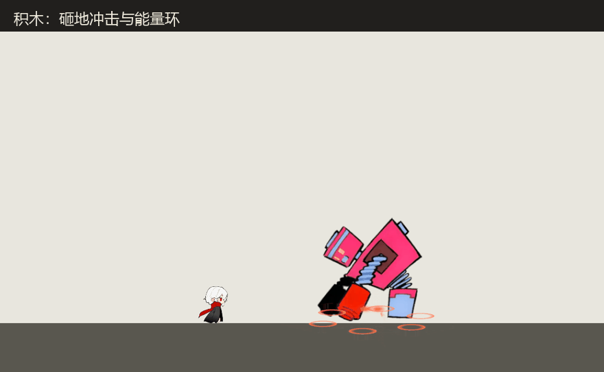
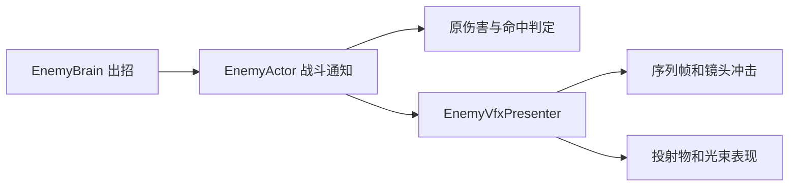

# Boss 特效接入

四个 Boss Prefab 和 `Test_Enemy_*Boss` 白盒已接入特效。打开白盒进入 Play 即可查看；主角默认无敌，F1 推进阶段。兔子角色美术仍是白盒。

下方为三个白盒的实战采样动图，取景放大到交战区域；没有修改正式关卡相机。它用于查看出招效果，不用于衡量帧率。

| Boss | 表现 |
| --- | --- |
| 积木 | 暖色蓄力、砸地冲击、带拖尾的冲击波、分裂能量环 |
| 闹钟 | 表盘发射细线预告，金色外焰和白色激光核心，墙面终点爆发 |
| 兔子 | 粉色能量环、弹体拖尾、出现和消失效果 |
| 蝙蝠 | 紫色三连斩、毛团弹拖尾、阶段碎裂 |

## 如何调整

`Assets/_Project/Data/Enemies/Vfx/*Boss_Vfx.asset` 分别配置各 Boss 的片段、材质、尺寸和镜头冲击。`EnemyVfxClip` 配置图集、8×8 网格、起始帧、结束帧总数和 30 FPS。无需安装 Effekseer 即可运行。

给新的 Boss 添加 `EnemyVfxPresenter`，指定 Profile；需要震屏的主相机添加 `BossCameraImpulse`。闹钟的 `EnemyActor.BeamOrigin` 指向表盘轴心，光束显示和伤害判定使用同一原点。

重新生成敌人白盒后，执行菜单 `RuleGame/Enemies/接入 Boss 作者特效（保留 AI 与参数）` 恢复接线。该工具只修改四个 Boss Prefab、特效配置和四个独立白盒。

## 与战斗逻辑的边界

特效订阅动作、攻击、成功规则释放和命中事件。持续攻击窗只通知一次，蝙蝠连斩每刀通知一次。特效不决定伤害、速度、冷却、阶段和规则持续时间。投射物外观使用独立子节点，根节点与碰撞半径沿用原实现。飞行弹芯持续使用 `ProjectileSprite`，`Shot` 仅用于发射瞬间的闪光；其末尾为透明淡出帧，不能循环替换弹芯，否则会周期性消失。

序列帧随世界时间缩放，Boss 实体暂停时停止播放；已发射弹体独立飞行。Boss 快照恢复后清掉旧时间线瞬时效果与拖尾。每个 Boss 最多 12 个复用播放槽，投射物与光束沿用现有对象池。公共弹池被无特效杂兵复用时恢复其原始外观。尚无距离裁剪；大量 Boss 同屏时需另行评估透明绘制成本。

## 资源来源

采用作者 **tktk** 的 [Effekseer Effects vol.2](https://effekseer.github.io/en/contributes/tktk02/index.html) 作品。当前贡献库明确标注 [CC0](https://effekseer.github.io/en/contribute.html)。保留七个 `.efkproj` 及所需纹理于 `Doc/特效资源/tktk02`，便于美术继续编辑。

运行资源是从作者原工程离屏烘焙的序列帧，做了统一中心裁剪、尺寸压缩、透明度转换、末尾渐隐和材质配色。Effekseer 1.80.7 仅作离线烘焙工具，未加入最终游戏依赖。来源及许可见该目录 README；重新烘焙见 `Tools/BossVfx/README.md`。
