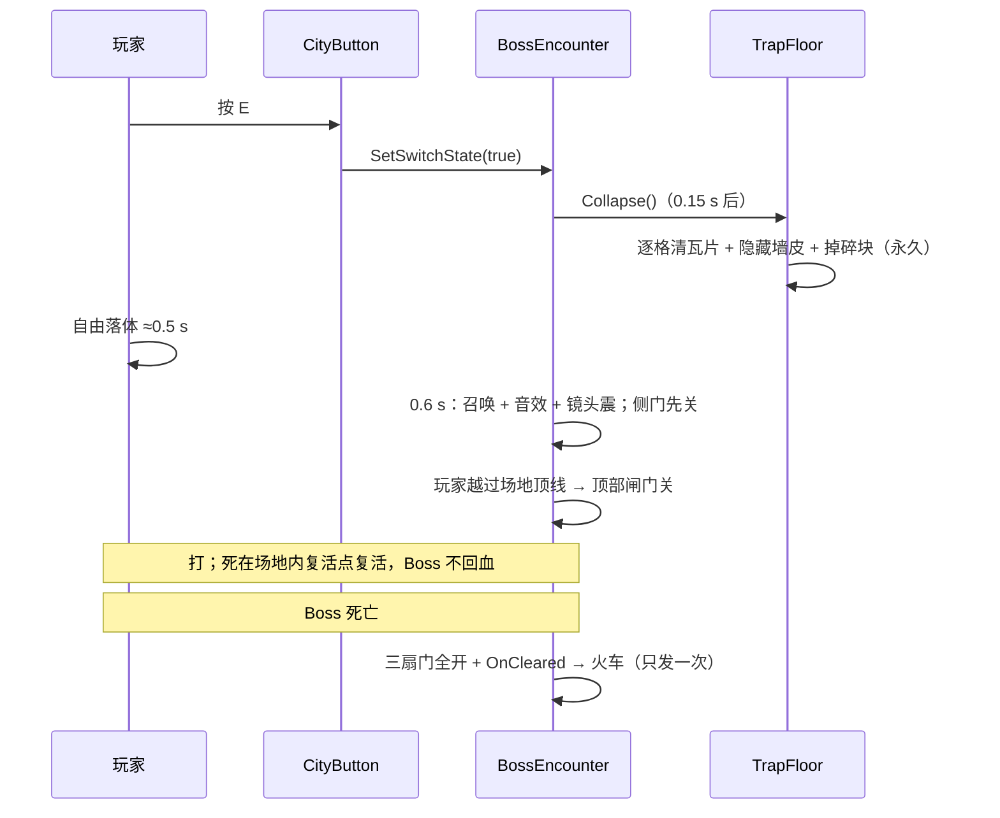

# 塌陷地面 + Boss 战 接入方案

> **状态：2026-10-19 已实现并自测。** 运行时脚本三个（`TrapFloor` / `TrapFloorDebris` / `BossEncounter`），
> 编译 0 错误；在编辑器里用**隔离预览场景**验证了清瓦片、美术隐藏、碎块生成与落地、门的开关与阶段机。
> 场景接线（第 7 节）还没做 —— 那部分要在关卡里摆。

---

## 0. 一句话

**按按钮 → 地板永久塌开 → 玩家掉进 Boss 房 → Boss 被召唤 → 侧门 + 顶部闸门关闭 → 打赢 → 全开、火车启用。**
死了在**场地内的复活点**复活，Boss 血量不重置。

拆成 **2 个组件**：`TrapFloor`（只管塌）与 `BossEncounter`（只管 Boss 战）。
开关复用 `CityButton`（`Toggle=0` 单次锁死）；门统一用 `CityGate`（`CityPathMotor`）；
火车挂 `BossEncounter.OnCleared`。

---

## 1. 调研结论（能直接用的）

| 需要 | 现成的 | 位置 | 结论 |
|---|---|---|---|
| 按钮 | `CitySwitch`（`CityButton` 默认单次锁死） | `Components/CitySwitch.cs` | 直接用 |
| 被驱动 | `ISwitchTarget.SetSwitchState(bool)` | `Common/ISwitchTarget.cs` | `BossEncounter` 实现 |
| 清地板 + 删墙皮 | `SecretWallField.RevealIn(Bounds)` | `Scene/SecretWallField.cs` | 照着写 |
| 碎块 | `BoulderFragment`（无碰撞体、无刚体、自积分） | `Scene/BoulderFragment.cs` | 抄成 `TrapFloorDebris` |
| Boss | `Prefabs/Enemies/BrickBoss.prefab` | `Enemy/EnemyActor.cs` | 直接用 |
| 场地边界 | `UseSpawnRelativeArena` + `ArenaSize`（**预制体现在是关的**） | 同上 | **必须勾** |
| 门 | `CityGate` = `CityPathMotor.SetOn(bool)` | `Components/CityPathMotor.cs` | `SetOn(false)` 关门 |
| Boss 死亡 | `EnemyActor.OnDefeated` | 同上 | 订阅 |
| 复活点 | `PlayerSpawnPoint`（`Activate` 可手动调） | `Scene/PlayerSpawnPoint.cs` | 放场内 |
| 音乐 | `MusicRegion` | `Presentation/Audio` | 零代码 |
| 召唤音 / 镜头震 | `SfxCue.BossSummon` / `BossCameraImpulse.Pulse` | — | 各一行 |

没有的：Boss 血条（不做）、落地伤害、击杀线、过场系统。

---

## 2. 两个组件

| 组件 | 职责 | 不认识 |
|---|---|---|
| `TrapFloor` | 清瓦片 / 关碰撞 / 掉碎块 / 永久开 | Boss、开关 |
| `BossEncounter` | 召唤、三扇门、复活点、开战、胜利、启火车 | 按钮是谁按的 |

---

## 3. 时序



---

## 4. 组件 A：`TrapFloor`

### 4.1 路线：清瓦片（照 `SecretWallField`）

| 项 | 做法 |
|---|---|
| 碰撞 | 逐格 `SetTile(cell, null)`，`TilemapCollider2D` 自动重建 |
| 美术 | 隐藏 `Grid/Art` 下 bounds 与塌陷区相交的 `SpriteRenderer` |
| 碎块 | `TrapFloorDebris`（无碰撞体、无刚体），逐格错峰，落地淡出 |
| 复原 | **不做**（拍板：永久开）。保留 `Restore()` 只给调试 |

⚠️ 不能只关碰撞体：`Grid/Logic` 整张表共用一个 `TilemapCollider2D`；
`Grid/Art` 的精灵是铺装器生成的独立子物体，和瓦片没有父子关系。两件事必须一起做。

### 4.2 字段

| 字段 | 默认 | 说明 |
|---|---|---|
| `_tilemap` | 自动找 `Grid/Logic` | 要清的表 |
| `_artRoot` | 自动找 `Grid/Art` | 要隐藏的美术根 |
| `_area` | 自身 `BoxCollider2D`（Trigger） | 塌陷范围 |
| `_collapseDelay` | 0.15 | |
| `_cellStagger` | 0.05 | 从中心向两边 |
| `_debrisPerCell` | 1 | 每格几个碎块；0 = 只开洞 |
| `_debrisScale` | 0.6 | 碎块相对原格的大小 |
| `_debrisSortingOrder` | 2 | 比地板（1）高一层 |
| `_debrisJitter` | 0.15 | 出生位置抖动 |

```csharp
public bool IsCollapsed { get; }
public event Action OnCollapsed;
public void Collapse();
public void Restore();   // 仅调试
```

### 4.3 约束

1. 记 `(cell, tile)` 再清；美术用 `SetActive(false)` 不用 `Destroy`。
2. 计时走 `Time.fixedDeltaTime` + `TimeManager.IsPaused` 闸门。
3. 碎块无碰撞体（否则砸 Boss / 顶玩家 / 卡墙缝）。
4. 碎块重力读 `Physics2D.gravity`（重力规则一翻就往上飘，零特判）。
5. 不进快照（`CityMechanism` 只认一个 `Shape`，多块瓦片表达不了）。
6. `TilemapCollider2D` 帧末重建，玩家下一物理帧才掉 —— 正常。

---

## 5. 组件 B：`BossEncounter`

### 5.1 Boss 必须**场景预摆 + 开局 inactive**

- 运行时生成的敌人常设 `RuntimeSpawned = true`，而 `EnemyActor.DiscardWhenMissing => RuntimeSpawned`。
- `SnapshotSystem.Restore` 第 ⓪ 步会把「名册里有、快照里没有、`DiscardWhenMissing`」的对象
  `SetActive(false)`，**之后再也不会打开**。
- 预摆 inactive 是免费保险：inactive 时 `Awake` 没跑 → `RuleAffectedBody.Body == null` →
  快照采集 `if (body == null) continue;` 跳过它；它又声明 `DiscardWhenMissing = false`。

**结论**：摆好、inspector 里关掉根物体、`RuntimeSpawned` 保持 0。

### 5.2 字段

| 字段 | 默认 | 说明 |
|---|---|---|
| `_boss` | — | 预摆的 `EnemyActor`，**inactive** |
| `_summonDelay` | 0.6 | 塌陷后多久召唤（≈ 落地） |
| `_summonVfx` | 可空 | 留空 = 用 Boss 自己的 `Cast`（§5.4） |
| `_sideDoors` | — | 下方左右两道门（`CityPathMotor` / `CityGate`） |
| `_topGate` | — | 洞口上方那道门（同样 `CityGate`） |
| `_arenaTopY` | — | 场地顶线；玩家 Y < 它 = 已在场内 |
| `_arenaSpawn` | — | 场地内的 `PlayerSpawnPoint` |
| `_onBegan` / `_onCleared` | — | `UnityEvent`；**火车挂 `_onCleared`** |

```csharp
public enum Phase { Dormant, Collapsing, Fighting, Cleared }
public Phase Current { get; }
public bool IsCleared { get; }
public void Begin();                  // 幂等
public void SetSwitchState(bool on);  // ISwitchTarget → Begin()
```

### 5.3 三条规则

**① 三扇门统一「`SetOn(false)` = 关」**

- 侧门：`Begin()` 当场 `SetOn(false)`（玩家还在上面，没有夹人风险）。
- 顶部闸门：**等玩家越过 `_arenaTopY` 再关**，否则会把坠落中的玩家夹在洞口。
- `Cleared`：三扇门 `SetOn(true)`（打开），之后不再动。
- 顶部闸门的 `EndOffset` 摆成「打开方向」，这样它和侧门是同一个语义，不用额外开关。

> 为什么不用固定延迟关顶部：玩家可能贴着墙慢慢滑（`_wallSlideSpeed = 6`），
> 固定 1 s 会把人夹在半空。用「Y 越过顶线」这一条判据最稳。

**② 侧门开关不用锁 —— 因为玩家够不到**

- 玩家死在场内、复活点也在场内，战斗期间根本走不到上面那道开门的开关，
  所以**不需要**「每帧重压 `SetOn(false)`」那套。
- ⚠️ 如果以后改成「死了回外面」，就必须补锁，而且**只能禁用 GameObject**：
  `CitySwitch.enabled = false` **拦不住任何人** —— 它的三个入口
  （`CityInteractor` 的 E 键、玩家攻击盒 `PressSwitches`、纸飞机 `PressSwitch`）
  都是**外部直接调公开方法**，靠 `GetComponentInParent` 拿组件，从不看 `enabled`。
  只有 `SetActive(false)`（碰撞体没了，`Overlap*` 找不到）才真的拦得住，代价是开关美术消失。
- 更干净的替代：给 `CitySwitch` 加一个 `Locked` 字段，`Available` / `Interact` /
  `ImpactByContact` / `PressByContact` 各加一行判断。**现在不需要，先不加。**

**③ 玩家死了什么都不重置**

- 开战瞬间 `_arenaSpawn.Activate(player)` 一次：就算玩家还没走到 1.2 m 内，
  场地内的复活点也已经写进玩家（防「掉在半路死了，复活到外面」）。
- Boss 血量 / 位置 / 阶段全保留；玩家在场外时 Boss 被 `ArenaX` 夹在场地边缘。
- 复活点放在**落点附近、离 Boss 召唤位远的一端**，`Revive` 自带 ≥1 s 无敌。

### 5.4 召唤演出：现有美术能到哪一步

调用一次 `_boss.EmitFeedback(EnemyFeedbackKind.Summon, 位置, Vector2.up)`：

| 层 | 现成的 |
|---|---|
| 特效 | `Profile.Cast`（`BrickBoss_Vfx` 已接：8×8 图集烘焙帧，5.5 尺寸，0.9 s） |
| 音效 | `EnemySfxPresenter` 在听 `Summon` → 自动放 `SfxCue.BossSummon` |
| 镜头 | `BossCameraImpulse.Pulse(0.12f, .22f)`（静态方法） |
| Boss | 出场后紧接 `Angry` 动作 + `BossPhaseChange` |

合起来是「爆发 + 闷响 + 抖屏 + 怒吼」，**零新美术**。
真正的传送门 / 法阵要美术出一张 sprite sheet（`EnemyVfxClip` 就是 8×8 图集 + 帧数 + 帧率），
接进去只改 `EnemyVfxProfile`，代码不动。按你的决定 v1 不做，`_summonVfx` 钩子留着。

---

## 6. 火车那一侧的最小契约

- 触发点：**`BossEncounter.OnCleared`**（Boss 战打赢），只发一次。
- 一次启用、永久生效 → 你们不用做去重。
- 接口面：一个公开的单参 `bool` 或零参方法挂到 UnityEvent 上即可。
- 时序（等车进站 / 开门 / 鸣笛）全在你们组件内部排队。

---

## 7. 场景搭建

| 步 | 做什么 | 注意 |
|---|---|---|
| 1 | 洞口上放 `CityButton` | 默认单次锁死 |
| 2 | 同位置挂 `TrapFloor`，Trigger `BoxCollider2D` 框住塌陷区 | 别盖到旁边的墙 |
| 3 | 房间摆 `BrickBoss`（远离落点） | **根物体关掉**；勾 `UseSpawnRelativeArena` |
| 4 | 放 `BossEncounter`，拖 `_boss` / `_sideDoors` / `_topGate` / `_arenaSpawn` | 门的引用拖组件或 GameObject 都行 |
| 5 | `_arenaTopY` 填洞口上方那条线 | §5.3① |
| 6 | 洞口上方摆 `CityGate`（顶部闸门），初始 = 开 | `EndOffset` 朝「开」的方向 |
| 7 | 场地内放 `PlayerSpawnPoint`（离 Boss 召唤位远的一端） | **房间外不要放** |
| 8 | `BossEncounter` 拖到按钮的 `FollowMotor` | `CitySwitch` 有类型兜底 |
| 9 | 场地放 `MusicRegion` | 零代码 |
| 10 | `OnCleared` 挂火车启用方法 | 只发一次 |

**尺寸**（`BrickBoss` 2 × 3.2；`PreferredDistance` 4 / `AttackRange` 6 / `RangedRange` 14）

| 项 | 建议 | 理由 |
|---|---|---|
| 洞口宽 | 4.5 m（9 格） | 玩家 + Boss 都掉得下去 |
| 竖井高 | 8 m | 落 0.5 s；超过二段跳 4.4 m |
| 场地内空 | 20 × 7.5 m | 够 6 m 近战 + 4 m 站位 |
| `ArenaSize` | 19 × 7 | 比内空小 0.5 m，Boss 不顶墙 |

---

## 8. 与既有系统的交界

| 系统 | 交界 | 注意 |
|---|---|---|
| 规则 | 地板 / 碎块不吃；Boss 吃 | 重力反转会把碎块往上吹 —— 故意的 |
| 暂停 | `TimeManager.IsPaused` | 塌陷 / 召唤 / 关门都要停 |
| 快照 | 本关拿不到时间规则 | 仍按 §5.1 摆，免费保险 |
| 伤害 | 不做落地伤害 | 真要做走 `CombatSystem` 传基础值 |
| 分区 | 房间必须与开关同一分区场景 | §9.1 |
| 复活 | 场地内的 `PlayerSpawnPoint` | 开战时强制激活一次 |
| 音效 / 音乐 | `BossSummon` / `MusicRegion` | 零代码 |

---

## 9. 坑

### 9.1 分区卸载会把房间从脚底下抽走 🔴

卸载线 = 矩形 + loadRadius(12) + hysteresis(8)：

| 分区 | 矩形 Y | 加载（≥） | 卸载（<） |
|---|---|---|---|
| `Level_Center` | −10 ~ 37 | −22 | **−30** |
| `Level_Start_01` | −10 ~ 28.5 | −22 | **−30** |

→ 场地地面别低于 y ≈ −20，或把该分区设 `AlwaysLoaded`。
→ 房间不要单独做成分区场景：异步加载等不起 0.5 s 的坠落。

### 9.2 `enabled = false` 拦不住开关 🟠

三个入口都是外部直接调公开方法（见 §5.3②）。要锁就禁 GameObject，或给 `CitySwitch` 加 `Locked`。
本关因为复活点在场内，用不上。

### 9.3 玩家能蹬墙爬出去 🟠

二段跳 ≈ 4.4 m，墙只要是 Ground 层就能蹬（`_wallJumpUpSpeed = 15`）。
→ 靠顶部闸门；挖深没用。

### 9.4 Boss 会跑出房间 🟠

`BrickBoss.prefab` 现在 `UseSpawnRelativeArena = 0`、`ArenaSize = 20×20`、`ArenaX = (−12, 12)`，
全是世界坐标。房间不在原点的话边界全错（`BrickBossBrain.AtArenaEdge` 读 `ArenaX`）。
→ **勾 `UseSpawnRelativeArena`**。

### 9.5 顶部闸门早关 / 晚关 🟠

早关 = 把人夹在洞口；晚关 = 玩家已经能蹬墙。用 `_arenaTopY` 判，别用固定延迟。

### 9.6 其他 🟡

- 碎块别带碰撞体。
- `OnDefeated` 的 `MarkDefeated` 不销毁对象，引用不会失效。
- 预摆的 Boss 激活后不要再 `SetActive(false)`（会走 `Brain.OnDisabled`，状态不干净）。
- `CityGate` 关门时 `CarryRiders` 会把站在门上的东西带走 —— 所以等玩家过去再关。

---

## 10. 已定 / 待定

**已定**

| # | 决定 |
|---|---|
| 1 | 塌陷**永久开** |
| 2 | 复活点在**场地内**；死了原地复活，场景不重置 |
| 3 | 封口 = 侧门两道 + 顶部一道 `CityGate`，统一 `SetOn(false)` = 关 |
| 4 | 打赢后三扇门全开；洞口**不封回去** |
| 5 | Boss 血条不做 |
| 6 | 时间回溯不管（本关没有时间规则） |
| 7 | 火车在打败 Boss 后启用，一次性永久 |
| 8 | 召唤演出 v1 不做，留钩子 |

**唯一还剩的**：侧门开关要不要顺手加个 `Locked` 字段（现在用不上，属于「以后改玩法时的保险」）——
我的倾向是**不加**，等真需要再说。

---

## 11. 工作量与文件清单

| 文件 | 状态 | 说明 |
|---|---|---|
| `Scripts/Gameplay/Scene/TrapFloor.cs` | ✅ 已写 | 清瓦片 + 隐藏墙皮 + 生成碎块 |
| `Scripts/Gameplay/Scene/TrapFloorDebris.cs` | ✅ 已写 | 无碰撞体、自积分、落地淡出 |
| `Scripts/Gameplay/Scene/BossEncounter.cs` | ✅ 已写 | `ISwitchTarget` + 门 + 阶段机 |
| `Scenes/Test_TrapBoss.unity` | ⬜ 未做 | 隔离测试场景（也可以直接在关卡里调） |
| `Prefabs/TrapFloor.prefab` | ⬜ 未做 | 不需要 —— 碎块用墙皮图**运行时生成** |

剩下只有**关卡接线**（第 7 节），不需要再写代码。

---

## 12. 验证计划

隔离场景跑，做完关掉不保存（工作区红线）。

| # | 断言 |
|---|---|
| 1 | 按 E 一次；第二次无效 |
| 2 | 0.5 s 内地板消失、玩家下落；没有碎块顶到玩家 |
| 3 | 玩家落进场地，Boss 在 1.0 s 内 active |
| 4 | 侧门开战后关上；顶部闸门在玩家越过顶线后才关 |
| 5 | 玩家在场内跳不出去 |
| 6 | Boss 不越出左右墙 |
| 7 | 玩家死亡 → **场地内**复活 → Boss 血量不重置 |
| 8 | Boss 死亡 → 三扇门全开、`OnCleared` 只发一次、火车只收到一次 |
| 9 | 暂停时塌陷 / 召唤 / 关门都停住 |
| 10 | 编辑器：Boss inactive、`RuntimeSpawned = 0`、`UseSpawnRelativeArena = 1` |

---

## 13. 实施记录（2026-10-19）

### 13.1 代码

| 组件 | 关键实现 |
|---|---|
| `TrapFloor` | 逐格 `SetTile(null)`；按**墙皮所在格子**隐藏美术（不是包围盒 —— 实测某张 cell 图的 `bounds.center` 离锚点 0.56 m，用包围盒会把隔壁的墙一起吃掉）；碎块**直接用墙皮图**，连轴心偏移 / 旋转 / 缩放一起继承，从原位起飞 |
| `TrapFloorDebris` | 无碰撞体、无刚体；重力读 `Physics2D.gravity`；**第一次物理步进才打落地射线**（地板瓦片刚清、`TilemapCollider2D` 帧末才重建，立刻探测会打到自己刚离开的地面）；落地 → 停留 → 淡出 → 自毁 |
| `BossEncounter` | `ISwitchTarget`；`Begin()` 幂等；侧门当场关、顶门等玩家越过 `_arenaTopY` 再关；`Clear()` 三扇门全开并只发一次 `OnCleared`；开战瞬间 `PlayerSpawnPoint.Activate` 一次 |

### 13.2 自测（隔离预览场景，未开 Play、未碰已打开的场景）

| 项 | 结果 |
|---|---|
| 清瓦片 | 4 格 → 0 格 ✅ |
| `Restore()` | 0 格 → 4 格，`IsCollapsed` 复位 ✅ |
| 美术隐藏 | 洞内的墙皮隐藏、洞外的保留 ✅ |
| 碎块生成 | 每格 1 个，共 1 个 ✅ |
| 碎块落地 | 从 y=0 落到地面并 `IsSettled = true` ✅ |
| 门 | 开战：两侧 `TargetEnd = false`；打赢：两侧 `TargetEnd = true` ✅ |
| 阶段机 | `Dormant → Collapsing → Cleared` ✅ |
| 编译 | 0 错误、0 新增警告 ✅ |

没测到的（需要真实关卡）：Boss 激活 / 召唤反馈、顶部闸门按玩家位置关闭、玩家复活走位。

### 13.3 关卡接线（已做，Level_Building_01）

2026-10-19 已在 `Assets/_Project/Scenes/BuildingBlocks/Level_Building_01.unity` 里接好并保存。
场地实测：**x 79.5~108、y −29.5~−14.5**（28.5 × 15），左右两侧下方各有一个开口。

| 对象 | 位置 | 说明 |
|---|---|---|
| `TrapFloor_Arena` | (90, −14.25) | 挂在 `Grid` 下；Trigger 框 12 × 0.6 → 洞口 **x 84~96**，26 格瓦片 / 25 张墙皮 |
| `CityButton_BossTrap` | (82.5, −14.0) | 洞口左侧一步；`FollowMotor` = `BossEncounter_Arena`；单次锁定 |
| `BossEncounter_Arena` | (94, −22) | `_trapFloor` / `_boss` / `_sideDoors`(2) / `_arenaSpawn` 已接；`_arenaTopY`=−14；`_summonDelay`=0.7 |
| `BrickBoss_Arena` | (94, −28.4) | 根物体 **inactive**；`UseSpawnRelativeArena` 勾上；`ArenaSize` 26 × 12；`RuntimeSpawned`=false |
| `PlayerSpawnPoint_BossRoom` | (94, −29.2) | `Id`=`boss_room`，`_applyWhenStandalone` 关掉 |
| 侧门 | `CityGate (1)` (74,−27) / `CityGate (3)` (108.3,−28) | 左下 / 右下两个开口 |
| 顶部第三道门 | `CityGate (5)` (108.25,−10) | 已接 `_topGate`；玩家落到 `_arenaTopY` 以下才关，打赢开 |
| 火车 | `TrainStation` (116.9,−12.5) | `OnCleared` → `TrainStation.UnlockStation()`；站本身 `_unlockRadius=0`、`_unlockedAtStart=false`，开局锁死 |

**顶部闸门没做**：场地宽 28.5 m，而蹬墙跳的横向推力只有 9 m/s、跳高 2.5 m —— 玩家跳不到对面墙，
爬不出 15 m 深的竖井。`_topGate` 留空，字段还在，以后真要加就拖一个 `CityGate` 上去。

**掉落高度 15.5 m**：玩家有效重力 ≈75 m/s²，约 **0.72 s** 落地，所以 `_summonDelay` 取 0.7 —— Boss 刚好在玩家落地时出场。

**火车解锁**：给 `TrainStation` 加了一个无参入口 `UnlockStation()`（内部 `Unlock(null)`，自己找玩家），
这样 `UnityEvent` 才挂得上 —— 原来只有 `Unlock(PlayerController)`，编辑器里的持久监听挂不了带参方法。
站本身半径已经是 0，所以**只能靠打死 Boss 解锁**，走近不会自动开。

**待办**：`MusicRegion` 没放（没有 Boss 音乐资产）。