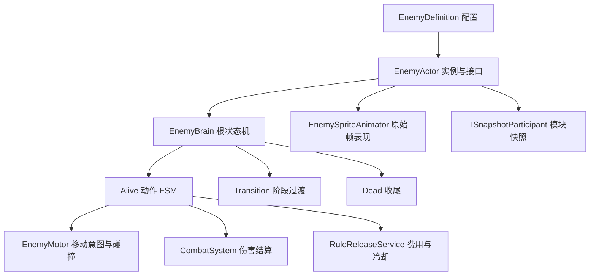
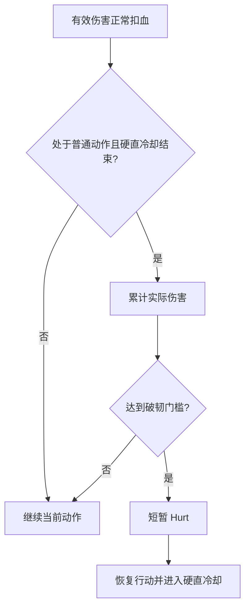
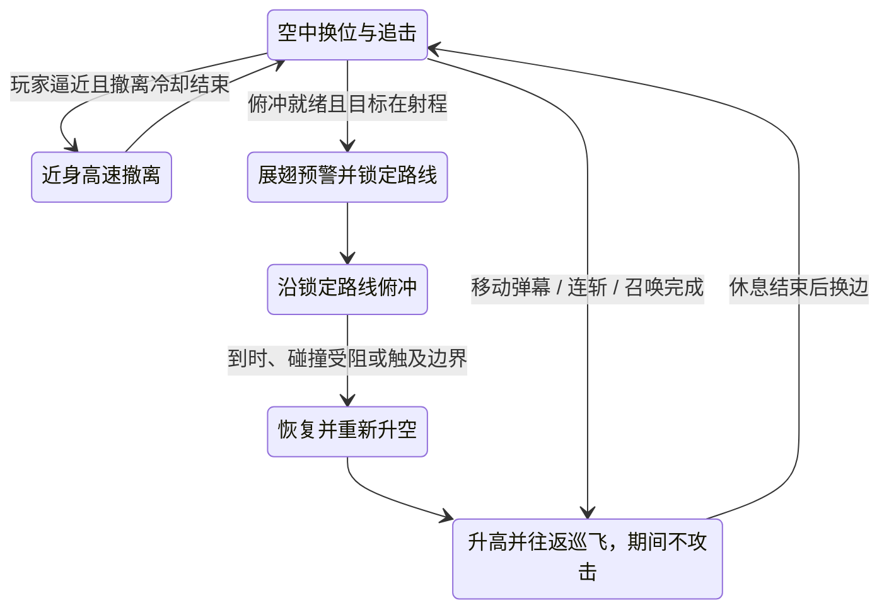

# 敌人系统接入

本模块按 `Doc/敌人逻辑` 的行为图和本次 `Doc/动画合集` 交付实现。当前范围是四个 Boss、积木分裂小怪和蝙蝠召唤物。旧策划案中的其它敌人不作为这版实现依据。

## 先运行白盒

在 Project 窗口打开 `Assets/_Project/Scenes/EnemyLabs` 中的场景，再进入 Play。每个场景有独立地形、`Test_RuleSystem` 当前主角（含动画）、一个敌人、规则系统和原有 Shift 轮盘。主角默认会受到伤害和击退，按 F5 可临时切换无敌；免疫开关由白盒控制器管理。

| 场景 | 主要观察内容 |
| --- | --- |
| `Test_Enemy_BrickBoss` | 距离选招，锤击、地面冲击波、投掷，三个分裂阈值，半血生气后分裂 |
| `Test_Enemy_BrickMinion` | 地面追击、接触攻击、受击与死亡 |
| `Test_Enemy_ClockBoss` | 三阶段指针激光，响铃后冲刺，三秒发条窗口，失败恢复 Boss 自身血量 |
| `Test_Enemy_RabbitBoss` | 出头/藏身二十秒轮换，半血翻转，规则施法后继续原动作；美术使用方块占位 |
| `Test_Enemy_BatBoss` | 三段劈砍、甩毛、飞行、阶段虚弱、召唤、指令、规则施法和三阶段冲刺 |
| `Test_Enemy_BatMinion` | 单独场景直接追击；Boss 召唤后先待命，收到前指命令再攻击 |

移动、跳跃、冲刺和攻击沿用 `Test_RuleSystem` 的 Input Actions 与主角控制参数。调试键：

| 按键 | 操作 |
| --- | --- |
| F1 | 将当前敌人生命调到下一阶段阈值；用于快速观察，不代表正式伤害结算 |
| F2 | 在发条暴露时击破发条 |
| F3 | 重开当前白盒，仅 Editor 可用 |
| F4 | 暂停/继续白盒 |
| F5 | 切换主角无敌；左上角显示主角生命与开关状态 |
| Shift | 使用现有规则轮盘 |

发条成功路线：F1 进入二阶段，再按 F1 露出发条，三秒内 F2。失败路线：露出发条后等待，不按 F2。Rabbit 的第二次 F1 触发谢幕。积木第一次 F1 会分裂，之后等待过渡结束再按下一次。

这些场景没有加入 Build Settings。`EnemyLabControls` 只属于开发白盒，不挂到正式敌人 Prefab。

## 结构和职责

依赖 UnityHFSM 2.3.0（MIT，UPM 固定到 `v2.3.0`）。Boss 的动作是一层 FSM，外面是 Alive / Transition / Dead 的 HFSM。发条的三个指针使用独立计时，不阻塞身体动作。本版本不引入 Unity Behavior，避免给同一敌人配置两套决策和打断逻辑。

- `Gameplay/Enemy`：行为决策、阶段、移动、攻击、召唤、发条弱点和投射物。
- `Presentation/Enemy`：Sprite 帧播放、朝向与指针显示。动画不会反过来决定伤害和移动。
- `Data/Enemies`：定义与动画集合。配置是共享资产；生命、阶段、冷却、随机状态都保存在实例上。
- `Prefabs/Enemies`：六个敌人 Prefab 和独立 `EnemyLabPlayer`。
- `Editor/Enemy`：导入与白盒生成工具。

伤害继续经过团队的 `CombatSystem` / `DamageProcessor`，包括伤害反转、挂账和因果规则。敌人只在 `ApplyDamage` 中处理自身无敌帧、阶段锁血、受击与击退。单次攻击的目标集合用于防止一个判定窗重复打同一实体；蝙蝠三段斩各自开启新的命中集合。

Boss 与小怪都有实体身体 BoxCollider2D。玩家移动由 PlayerController 将 `_bodyBlockLayer` 传入 MotionTuning，再由 MotionMover 将身体层与地形层一起交给 Slide；敌人移动也会检测 PlayerMask，因此双方不能直接走穿。接地、蹬墙和悬崖探测仍只查询地形层。接触伤害的 `ContactPadding` 默认向外扩展 0.05 米，覆盖 Slide 留下的微小间隙；持续贴身按 ContactInterval（默认 0.6 秒）结算一次。可在 EnemyDefinition 关闭 ContactDamage。

规则施法使用 `RuleReleaseService`，来源为 `RuleSource.Enemy`。费用、冷却、时长、覆盖语义由共享系统决定，敌人不直接写全局时间或规则属性。`EnemyDefinition.RuleAttribute` / `RuleRelation` 可配置施放哪条规则；默认积木、兔子、蝙蝠使用重力弱化，发条使用时间弱化，均为白盒演示配置。

## 接入正式地图

1. 地图中先有团队的 `RuleSystemDriver` 与 `CombatSystem`，不要每个敌人再放一份启动器。
2. 拖入对应敌人 Prefab。为 `EnemyActor.Target` 指定正式玩家 Transform，为 `Combat` 指定地图里的战斗系统。
3. 将地形放入 Ground 层（当前 Layer 8），敌人放入 Enemy 层（Layer 9）。`EnemyMotor.SolidMask` 控制地形碰撞，`EnemyActor.PlayerMask` 控制攻击目标。默认白盒玩家在 Default 层；正式玩家使用其它层时必须改 PlayerMask。
4. 改 `EnemyActor.ArenaX` 为本次战斗区域的左右边界；发条折返与蝙蝠冲刺会使用它。正式地图需要更复杂的平台路线时扩展 Motor 的导航输入，目前只有地面追击、悬崖探测和直线飞行，不提供跨平台寻路。
5. 在 `EnemyDefinition` 调数值、攻击距离、冷却和动作时长。初始生命与能量由定义同步到 EntityStatus，改配置后重新运行即可。动画集合按动作名绑定，正式美术更换不会影响 Brain 和 Combat。
6. 地图流程监听 `EnemyActor.OnDefeated` 或团队的 `CombatSystem.OnEntityDied` 结束战斗、开门、掉落。敌人不会自行切地图、保存游戏或播放正式结算。

编辑器工具修改 Prefab 实例的 Target 等引用时，必须使用 SerializedObject 或记录 Prefab 覆盖，不能只直接赋值；否则保存重开后可能丢失目标。生成和换主角工具已按此方式接线，已有白盒可调用 `EnemyLabBuilder.RepairLabReferences()` 修复引用。

积木的 `MinionPrefab` 和蝙蝠的 `FlyingMinionPrefab` 已配置。召唤物自动继承 Target、Combat 和 Summoner；上限为八个活跃召唤物。Boss 死亡会结束自己的召唤物。项目中的正式玩家需要 `IFactionMember.Faction == Player` 才会被敌人攻击选中。

## 动画导入与交付缺口

本次导入 382 张 PNG，组成 35 个动作/指针序列；蝙蝠召唤物暂用 Boss 帧缩小显示。交付标注为每秒八帧，默认按原始节奏播放。移动使用 Rigidbody2D 插值，图像使用每个角色固定 PPU 和固定身体碰撞体，不通过逐帧改缩放补齐尺寸。

`Tools/EnemyAssets/import_resources.py` 从 Doc 复制 PNG，保留原图字节，记录来源、角色 PPU、尺寸与脚底锚点到 `EnemyArtManifest.json`。锚点取主要不透明区域，忽略远处的孤立导出标记。Editor 导入器使用 Sprite Editor Data Provider 设置 pivot 和导入参数。PSD、MP4、背景音乐、场景组件和序幕原稿留在 Doc，未批量导入运行时。

当前兔子文件夹为空，因此没有兔子动作帧；发条只有分针和时针，没有秒针，秒针暂用原时针图做细长版本。三根针以连接圆点为轴心，并跟随各帧表盘中心。兔子动画到位后，在 `RabbitBoss_Animations.asset` 配置 Pop、Throw、Hide、HideThrow、Flip、FlipThrow、Magic、Hurt、Dead 即可。动画资源缺失时使用 Idle 或现有白盒，行为仍可验证。

重新导入原始资源：先运行 Python 脚本，再在 Editor 调用 `EnemyArtImporter.Import()`。菜单 `RuleGame > Enemies > 重建全部敌人白盒（覆盖生成配置）` 会重新生成定义、动画集合、Prefab 和六个白盒。它会覆盖生成资产中的手工调参；正常调整不需要重建。只更新当前主角时调用 `EnemyLabBuilder.RefreshLabPlayers()`，会复制完整主角层级、更新六个白盒的引用，不改敌人配置与地形。

## 数值与文档冲突

积木 Boss 的生命 100、伤害 10，分裂小怪生命 11、伤害 5，使用动作需求表中已填写的数据。其它 Boss 的完整数值未交付：发条生命 150、蝙蝠生命 300、兔子生命 100、蝙蝠召唤物生命 25，均为可改的白盒默认值。部分行为距离、出手时点、激光预警和招式冷却也是演示配置，不代表最终平衡。

兔子普通投掷间隔存在冲突：Markdown 写 0.5 秒，行为 Drawio 写 2 秒，倒置投掷为 0.5 秒。本版普通/藏身投掷采用 Drawio 的 2 秒，可在 RabbitThrowInterval 修改。兔子半血翻转与低于 20 谢幕按交付的绝对生命阈值实现。

发条回溯失败只将 Boss 自身生命恢复到最大生命的 3/5，仍处于二阶段；不会触发玩家和世界回档。

## 世界快照接口

新增可选 `ISnapshotParticipant`：共享 SnapshotSystem 先恢复物理与 EntityStatus，再调用模块恢复。已有不实现该接口的实体保持原有行为。

敌人快照包含 HFSM 状态、阶段、动作进度、各攻击计时、移动速度/冲量、无敌帧、分裂标记、召唤关系和随机状态。投射物、激光和发条弱点各保存自己的模块状态。回到召唤/发射之前时，主动声明 `DiscardWhenMissing` 的临时对象会停用。死亡和过期对象停用而不立即 Destroy，仍存活的对象可被已有快照恢复。

这是现有内存快照的扩展，不是对话存档或持久化敌人存档。正式关卡在离开战斗区域时可以随场景统一清理对象；若要跨场景保存敌人状态，需要另行定义持久化数据。

## Boss 距离与硬直（2026-10-15）

普通命中照常扣血、播放命中特效；只有短时间内累计的**实际扣血量**达到 `StaggerDamageThreshold`，Boss 才进入 `Hurt` 并中断动作。当前默认积木为 20，发条与兔子为 30，蝙蝠为 40。主角基础伤害 10 时，分别约需连续命中 2 / 3 / 3 / 4 次；伤害规则会改变所需次数，重击也可能一次破韧。

`StaggerResetDelay` 默认 1.5 秒：超过这个间隔未命中，下一次从零累计。`BossHurtDuration` 将普通硬直限制在 0.45 秒以内，之后有完整的 4 秒 `HurtCooldown`；冷却期间仍正常扣血，但不累计下一次硬直。阶段过渡清空累计量；阶段虚弱、发条眩晕与小怪的普通受击保留原机制。累计量、最后命中时刻与冷却均进入内存快照，暂停时冻结。

四个 Boss 完成一套攻击后进入明确的 `Rest` 休息状态：不选新招，不施法；地面 Boss 原地休息，蝙蝠升高并往返巡飞。地面默认 1.8 秒，蝙蝠默认 3.2 秒，由 EnemyDefinition 的“Boss 进攻后的喘息”中的 `BossRestDuration` 调整；此窗口不随阶段加速缩短。攻击冷却包含这段休息，若 `AttackCooldown` 更长，剩余冷却期间才恢复距离调整。休息中可以正常受到伤害；破韧恢复后继续剩余休息，阶段过渡和死亡仍可优先打断。休息计时与恢复动作均参加暂停和快照。

发条的并行指针也遵守休息：默认连续两轮激光后结束远程压制；冲撞就绪且目标同高度时接一段响铃冲撞，否则直接休息。轮数由 `ClockBeamVolleysBeforeRest` 调整；同一物理帧多根指针算一轮。指针时钟在休息中冻结，结束后继续剩余间隔，不补发积压激光。兔子每轮投掷后休息，翻转后的三发散射算一轮；蝙蝠三段斩或一组弹幕完成后也休息，俯冲先完成恢复段再升高巡飞。已经发出的投射物、激光及召唤物继续按原机制结算。

恢复行动后，靠近和后撤仍采用距离缓冲区，避免在临界距离反复启停；后撤受 `ArenaX` 边界限制，地面碰撞和悬崖检测仍由 `EnemyMotor` 负责。地面 Boss 按水平距离选招，近战另检查高度差，避免向头顶目标空挥。

| Boss | 距离策略 |
| --- | --- |
| 积木 | 中距压近，近距重锤；后续阶段接有限连招，远处或高处目标用锁定投掷 |
| 发条 | 瞄准与错位激光封路，择机锁向冲撞，组合进攻后休息 |
| 兔子 | 近身藏身撤退，墙角高抛；快弹/高抛交替，翻转后有限散射，休息结束再站位 |
| 蝙蝠 | 持续空中换位，近距撤离或连斩，中距移动弹幕，第一阶段起即可蓄力俯冲；召唤和施法保留阶段条件 |

`RangedRange` 默认 9，`PreferredDistance` 默认 5（发条、兔子使用），`SpacingTolerance` 默认 0.6，`RetreatSpeedMultiplier` 默认 0.8。积木靠近目标是 `AttackRange × 0.85`。普通命中不会直接重新选招；目标被停用后停止追击和新投射物发射。

## 积木、发条与兔子的战术重做（2026-10-16）

| Boss | 新进攻节奏 | 可利用的空档 |
| --- | --- | --- |
| 积木 | 同高度中距离快步压近，再锁定锤击；玩家绕后则停步重新预警地面波。分裂后的阶段可锤人接地面波，逃远则接投掷；投掷在起手时锁定短暂预判位置，后期追加高弧线砖块。避免连续重复同一远程招式。 | 每招保留原动画前摇；第一阶段单招，后续连招默认最多两招，完整结束后休息。 |
| 发条 | 第一根指针瞄准玩家，第二根错位封路，第三根分叉覆盖两侧；预警和判定期间站定。激光压制后择机响铃，锁定方向短程冲撞。 | 响铃和冲撞期间不叠加激光；冲撞到边界、受阻或超时即停止，不再折返追杀；一轮结束后休息。 |
| 兔子 | 被逼近时先藏身，再沿预定方向快速撤退、重新现身；墙角无空间则用高抛反击。正常投掷交替快弹与高抛；翻转后默认两轮三发散射。 | 藏身有独立 CD，路线不跟着玩家抖动，不获得额外无敌或穿人能力；每轮投掷结束后原地休息，再调整距离。 |

新参数均在 EnemyDefinition Inspector 的“积木压迫与连招”“发条封路与冲撞”“兔子藏身与弹幕”调整。阶段分裂、发条核心、失败回溯、兔子半血翻转和生命阈值保持原设计；新决策状态、招式朝向、冷却、弹道和计数参加内存快照。

兔子尚无正式动画，继续使用白盒占位；藏身侧移时以半透明显示，现身后恢复，散射增加蓄力特效。积木快步与发条冲撞沿用原动画速率，不将长序列压缩进短移动时长。

本轮只运行 `BossCombatValidation.RunTacticsBatch` 的 28 项针对性检查并通过编译，覆盖新选招、投掷/冲撞锁定、连招上限、兔子藏身/墙角反击/弹幕、休息和暂停快照；结果为 `Logs/BossTacticsValidation.txt`。没有重跑整套飞行、碰撞或表现验证，也未执行 Player 构建。

## 蝙蝠高机动空战（2026-10-15）

基础巡航速度从 2.5 提到 5.5，飞行加速度 70。行动期间移动到玩家侧上方（水平偏移 4.5、高度偏移 3），每次攻击后更换侧翼，先完成休息再继续换位。弹幕和召唤等动作也允许较慢侧移。近身时以巡航速度的 1.7 倍撤离；撤离有独立冷却，休息期间保持自己的高空航线，不会因玩家逼近提前转入撤离或攻击。

第一阶段即可发动俯冲，前摇用 `DashWindup` 的四帧抬翼短序列与蓄力特效。短序列截取自完整展翅的开头，基础预警 0.5 秒时按原来的 8 帧/秒播放；完整的 23 帧 `WingSpread` 只用于原有施法，不能压缩进 0.5 秒，否则反复拍翼会像抽搐。进入前摇时按玩家位置与短暂运动估计锁定路线，此后不会自动追踪闪避的玩家。俯冲 0.65 秒、速度约为巡航的 3 倍，之后有 0.45 秒恢复段。达到破韧门槛仍可打断前摇和俯冲，普通轻击不会直接取消动作。

后续阶段巡航与突进速度增加，并缩短预警、攻击间隔和机动冷却；休息时长与阶段虚弱窗口保持原配置。水平范围沿用 `EnemyActor.ArenaX`，新增 `ArenaY`（默认 0～10）限制飞行高度；正式地图应按房间内壁填写上下界。机动参数位于 EnemyDefinition 的“蝙蝠空战”，可单独调预警、俯冲、撤离和恢复时长，不需改角色动画资源。

蝙蝠休息时的高度取场地高度的 80%，围绕休息起点左右各 2.5 米巡飞，速度为基础飞行速度的 0.85 倍。路线在进入休息时固定，不跟踪玩家，身体受场地边界约束；暂停冻结巡飞，快照保存端点与巡飞方向。飞行实体不使用 Slide 的贴地吸附，落地后仍能正常升空。高度比例、巡飞距离与速度可在 EnemyDefinition 的“蝙蝠休息巡飞”调整；重建白盒会保留同样的默认设置。

`BatFlightValidation.RunBatch` 在隔离工程中读取真实蝙蝠配置、使用正常 FixedUpdate 和物理模拟验证飞行轨迹、第一阶段俯冲、锁定方向、撤离、边界、暂停和快照。`BossCombatValidation.RunBatch` 检查状态机与阶段/破韧规则；`BossBodyCollisionValidation.RunBatch` 使用真实 Input System 输入验证身体阻挡。均只在可丢弃的工程副本运行，结果存入该工程 `Logs/`。

可在可丢弃的工程副本中运行 `-batchmode -nographics -executeMethod RuleGame.Editor.Enemy.BossCombatValidation.RunBatch`。验证器进入 Play Mode 并自行退出；检查距离选招、追退意图、边界、硬直门槛/冷却/扣血、目标丢失、暂停、快照和阶段过渡。结果默认保存到 `Logs/BossCombatValidation.txt`，可用 `RULE_BOSS_OUTPUT` 指定绝对路径。它使用隔离对象直接推进 AI 时钟，不替代正式白盒地图中的碰撞、动画观感与操作手感验收。
