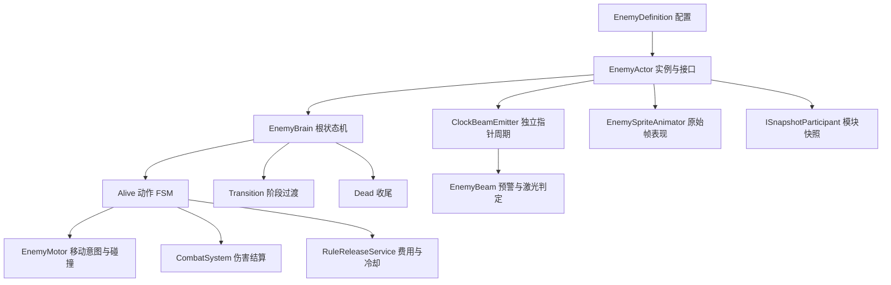
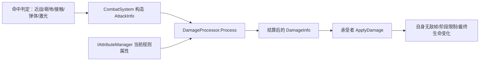
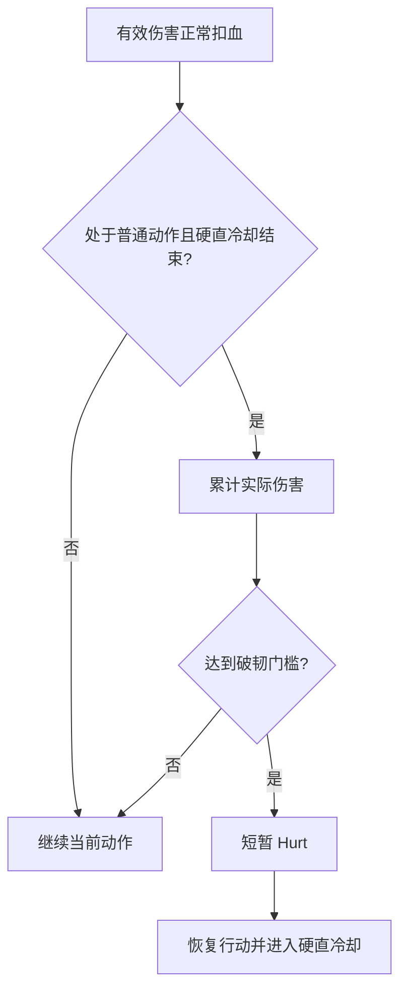
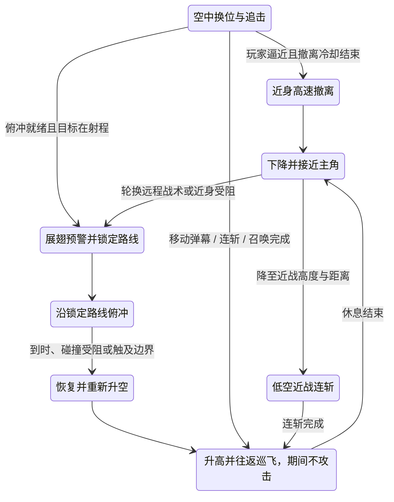

# 敌人系统接入

本模块按 `Doc/敌人逻辑` 的行为图和本次 `Doc/动画合集` 交付实现。当前范围是四个 Boss、积木分裂小怪、蝙蝠召唤物，以及动作需求表新增的九种关卡小怪。新增小怪按“小怪行为数据详细”页接入，未交付正式美术的部分使用白盒表现。

## 先运行白盒

在 Project 窗口打开 `Assets/_Project/Scenes/EnemyLabs` 中的场景，再进入 Play。每个场景有独立地形、`Test_RuleSystem` 当前主角（含动画）、一个敌人、规则系统和原有 Shift 轮盘。主角默认会受到伤害和击退，按 F5 可临时切换无敌；免疫开关由白盒控制器管理。

| 场景 | 主要观察内容 |
| --- | --- |
| `Test_Enemy_BrickBoss` | 距离选招，锤击、地面冲击波、投掷，三个分裂阈值，半血生气后分裂 |
| `Test_Enemy_BrickMinion` | 地面追击、接触攻击、受击与死亡 |
| `Test_Enemy_ClockBoss` | 三阶段指针激光和交替全局变速，响铃后抱头来回跑，发条窗口，失败恢复 Boss 自身血量；额外环形弹可用左上角按钮开启，默认关闭 |
| `Test_Enemy_RabbitBoss` | 近身藏身撤退、正常投掷与半血翻转；已接入正式兔子、帽子和投掷物动画 |
| `Test_Enemy_BatBoss` | 三段劈砍、甩毛、飞行、阶段虚弱、召唤、指令、规则施法和三阶段冲刺 |
| `Test_Enemy_BatMinion` | 单独场景直接追击；Boss 召唤后先待命，收到前指命令再攻击 |

移动、跳跃、冲刺和攻击沿用 `Test_RuleSystem` 的 Input Actions 与主角控制参数。调试键：

| 按键 | 操作 |
| --- | --- |
| F1 | 将当前敌人生命调到下一阶段阈值；用于快速观察，不代表正式伤害结算 |
| F2 | 在发条暴露时击破发条 |
| F3 | 重开当前白盒，仅 Editor 可用 |
| F4 | 暂停/继续白盒 |
| F5 | 切换主角无敌；左上角显示主角生命与开关状态 |
| Shift | 使用现有规则轮盘 |

发条成功路线：F1 进入二阶段，再按 F1 露出发条，窗口内按 F2（当前高难配置为 1.15 游戏秒）。失败路线：露出发条后等待，不按 F2。Rabbit 的第二次 F1 触发谢幕。积木第一次 F1 会分裂，之后等待过渡结束再按下一次。

这些场景没有加入 Build Settings。`EnemyLabControls` 只属于开发白盒，不挂到正式敌人 Prefab。

## 四 Boss 高难配置（2026-10-16）

本轮通过密集投射物、大范围攻击、连续进攻和频繁变速提高压力。伤害继续走原本的 CombatSystem / DamageProcessor / EnemyActor；原设计已有的阶段阈值和时钟发条窗口保留。没有新增规则护甲、额外减伤、通关锁血或指定组合破甲。

| Boss | 当前攻击配置 |
| --- | --- |
| 积木 | 砸地连续三波，间隔 0.24 秒；每波覆盖横向 13 米、高 2.2 米的地面区域，同时发出左右冲击波和九发上抛碎块。投掷改为九发、64° 扇形，三阶段追加第二扇；第二阶段起最多三招连段，休息 0.4 秒。 |
| 时钟 | 三针激光宽度为 0.32 / 0.45 / 0.58 米，停火间隔为 0.9 / 0.6 / 0.3 秒；响铃后抱头乱跑 3 游戏秒，遇玩家、墙或边界折返，接触不提前结束动作。乱跑冷却 3.2 秒，发条窗口 1.15 秒。额外环形弹幕默认关闭，左上角按钮可开启：一至三阶段分别为 24 / 32 / 40 发，预警 0.45 秒，释放后间隔 1.6 秒再蓄力，相邻轮旋转 11°。 |
| 兔子 | 普通上抛一次七发，落点围绕锁定位置以 1.1 米间距展开；倒立散射三轮，每轮十一发覆盖 110°，轮间隔 0.2 秒。保留逐落点上抛解算、起飞间距和近身藏身撤退；休息 0.4 秒。 |
| 蝙蝠 | 甩毛六轮交错扇形，每轮十三发覆盖 96°，轮间隔 0.18 秒，首轮另叠加二十四发环形弹；召唤、施法和指令也伴随环形弹。移速 7.2，俯冲冷却 1.8 秒，休息 0.35 秒。 |

时间槽为空时，时钟开战后第 0.8 个游戏秒首次施放「时间增强」。此后等待当前时间规则完整结束，再间隔 2.2 个游戏秒交替施放「时间弱化 / 时间增强」，不再每隔 2.2 秒提前覆盖。结束时刻读取共享规则表，不在 Boss 中硬编码规则持续时间。玩家途中替换时间规则时，Boss 也等该规则结束；关卡永久时间规则仍生效时持续等待。通过共享 `RuleReleaseService` 正常扣能量、检查冷却，倍率沿用现有规则的 2 倍 / 0.5 倍；玩家、敌人和弹体共同变速。每次花费 20 能量，时钟回能为每游戏秒 14；失败会间隔 0.5 游戏秒重试。规则轮盘的慢时间继续由 TimeManager 合成，不在 Boss 中直接写 `Time.timeScale`。

以上间隔均按游戏时间计时，会随全局倍率变化。「时间失效」期间指针仍转、已有激光收尾，不再启动新的激光或环形弹幕；Boss 等时间槽结束后才开始下一次变速间隔。等待规则结束的状态、变速施法与弹幕定时、蓄力状态、相位角均进入 Boss 快照，沿用已有回溯流程；等待施法不阻塞身体动作与普通弹幕。

基础伤害为 22～24，普通受击硬直上限 0.18 秒、硬直冷却 5 秒。最大血量与原画动作时长沿用原配置。特效复用已交付的蓄力、能量环、命中和弹体表现；砸地范围有地面预警，可选环形弹幕有独立蓄力预警，不会被身体换招取消；大量瞬时命中特效占满播放槽时优先保留弹幕预警。

时钟交付行为图的主要招式是指针激光、跳起响铃后的抱头乱跑，以及阶段发条弱点和失败回血。全局加快/减慢为后续需求；环形弹是额外高难选项，通过 `ClockExtraBarrageEnabled` 设置初始状态，默认关闭。白盒左上角的「额外环形弹幕：关闭/开启」按钮只切换当前 Boss 实例，不改共享资产；关闭会取消未释放的蓄力、停止后续发射，已发射弹体正常飞行至命中/超时。开关、蓄力和乱跑掉头计时均随 Boss 快照恢复。

弹体沿用对象池，单只 Boss 同屏弹体上限为 192（蝙蝠为 256），寿命 7 游戏秒，达到上限后跳过新弹体。现有特效每只敌人最多十二个播放槽，发射特效仍节流；弹体伤害不因特效节流被跳过。白盒左上角显示当前弹体数量，时钟额外显示全局时间状态和成功变速次数；F5 可以切换玩家无敌方便观察。

难度配置保存在四份 `*_Definition.asset` 和中文 Inspector 中。新字段默认保留单波/原数量；时钟定义资产开启自动变速，额外环形弹保留数量配置但默认关闭。重建白盒会保留已有定义资产，避免覆盖团队调参。本轮四个相关程序集通过离线 C# 编译；尚未进行本轮 Play、画面和性能验收，实际强度与弹幕可读性需在四个 `Test_Enemy_*Boss` 场景手动试玩。

## 结构和职责

依赖 UnityHFSM 2.3.0（MIT，UPM 固定到 `v2.3.0`）。Boss 的动作是一层 FSM，外面是 Alive / Transition / Dead 的 HFSM。发条的三个指针使用独立计时，不阻塞身体动作。本版本不引入 Unity Behavior，避免给同一敌人配置两套决策和打断逻辑。

- `Gameplay/Enemy`：行为决策、阶段、移动、攻击、召唤、发条弱点和投射物。
- `Presentation/Enemy`：Sprite 帧播放、朝向与指针显示。动画不会反过来决定伤害和移动。
- `Data/Enemies`：定义与动画集合。配置是共享资产；生命、阶段、冷却、随机状态都保存在实例上。
- `Prefabs/Enemies`：六个敌人 Prefab 和独立 `EnemyLabPlayer`。
- `Editor/Enemy`：导入与白盒生成工具。

伤害继续经过团队的 `CombatSystem` / `DamageProcessor`，包括伤害反转、挂账和因果规则。敌人只在 `ApplyDamage` 中处理自身无敌帧、阶段锁血、受击与击退。单次攻击的目标集合用于防止一个判定窗重复打同一实体；蝙蝠三段斩各自开启新的命中集合。

### 规则接入核对（2026-10-16）

四个 Boss、两种小兵和时钟发条都挂有 `RuleAffectedBody`，进入共享注册表。注册组件齐全不等于每种自定义运动都已完整消费所有规则，目前边界如下：

| 属性 | 已接入路径与边界 |
| --- | --- |
| 重力 | 地面 Boss 和带重力的抛物线弹读取 `Physics2D.gravity`。地面 Motor 的吸附改为仅接地时沿当前重力方向启用，离地时关闭，避免默认向下吸附抵消反转；发条弱点跟随身体的上下方向。飞行 AI 仍主动控制竖直速度，直线弹的重力倍率为零，这两类尚不表现全局重力变化。 |
| 时间 | 世界变速、暂停和快照参与已接入；时钟激光及可选环形弹读取「时间机制失效」。其余 AI 的招式计时、冷却还没有统一消费此开关，不能宣称全部适配。 |
| 摩擦 | 地面移动读取摩擦缩放和方向反转；碰撞材质由适配组件管理，空中移动不按接触摩擦减速。 |
| 质量 | 适配组件更新刚体质量，小兵击退按质量折算。Boss 本体沿用不受击退的设计，自定义 Motor 加速度也未按质量折算，因此质量尚没有完整的 Boss 操作反馈。 |
| 伤害、因果 | 所有正式敌人攻击走同一 `DamageProcessor`，模块读取 `IAttributeManager` 处理缩放、反转、失效、挂账与因果目标转换/扩散，再调用承受者；敌人不自行重复计算规则倍率。 |

正式攻击入口已核对：近战和砸地走 `CombatSystem.PerformAttack`，身体接触、投射物和激光走 `CombatSystem.ApplyDamage`；两个入口内部均构造 `AttackInfo` 并调用 `DamageProcessor.Process`。`EnemyActor.ApplyDamage` 和 `EnemyWeakPoint.ApplyDamage` 接收的是结算后的 `DamageInfo`。

F1 调阶段、F2 强制击破发条是开发调试，直接改状态而非正式攻击，不用于验证伤害规则；时钟发条失败后的阶段回血也是 Boss 机制状态恢复。不得把这些调试/阶段入口复制成正式攻击逻辑。本次移动修复已通过程序集编译；隔离物理检查及原场景体验结果另行记录，未完成时不视为 Play 验收。

Boss 与小怪都有实体身体 BoxCollider2D。玩家移动由 PlayerController 将 `_bodyBlockLayer` 传入 MotionTuning，再由 MotionMover 将身体层与地形层一起交给 Slide；敌人移动也会检测 PlayerMask，因此双方不能直接走穿。接地、蹬墙和悬崖探测仍只查询地形层。接触伤害的 `ContactPadding` 默认向外扩展 0.05 米，覆盖 Slide 留下的微小间隙；持续贴身按 ContactInterval（默认 0.6 秒）结算一次。可在 EnemyDefinition 关闭 ContactDamage。

召唤物同样使用非 Trigger 的身体盒；`EnemyMotor.BodyBlockMask` 默认包含 Enemy 层，因此小兵、Boss 之间也参与移动阻挡。召唤点从 Boss 身体外侧向两边展开，先检查地形、玩家和已有敌人的占位，空间不够则少生成，避免从重叠状态互相卡住。召唤物继承 Boss 的 PlayerMask、移动碰撞层及场地范围，正式地图更换玩家层后不会仍然只检测 Default 层。

规则施法使用 `RuleReleaseService`，来源为 `RuleSource.Enemy`。费用、冷却、时长、覆盖语义由共享系统决定，敌人不直接写全局时间或规则属性。`EnemyDefinition.RuleAttribute` / `RuleRelation` 可配置普通施法组合；积木半血生气后的规则改为质量增强，其余敌人沿用各自定义资产。时钟的全局加快/减慢由独立定时施法交替指定，不修改共享定义资产；响铃冲撞本身不触发规则或世界回溯。

## 接入正式地图

1. 地图中先有团队的 `RuleSystemDriver` 与 `CombatSystem`，不要每个敌人再放一份启动器。
2. 拖入对应敌人 Prefab。为 `EnemyActor.Target` 指定正式玩家 Transform，为 `Combat` 指定地图里的战斗系统。
3. 将地形放入 Ground 层（当前 Layer 8），敌人放入 Enemy 层（Layer 9）。`EnemyMotor.SolidMask` 控制地形碰撞，`EnemyActor.PlayerMask` 控制攻击目标。默认白盒玩家在 Default 层；正式玩家使用其它层时必须改 PlayerMask。
4. 改 `EnemyActor.ArenaX` 为本次战斗区域的左右边界；发条折返与蝙蝠冲刺会使用它。正式地图需要更复杂的平台路线时扩展 Motor 的导航输入，目前只有地面追击、悬崖探测和直线飞行，不提供跨平台寻路。
5. 在 `EnemyDefinition` 调数值、攻击距离、冷却和动作时长。初始生命与能量由定义同步到 EntityStatus，改配置后重新运行即可。动画集合按动作名绑定，正式美术更换不会影响 Brain 和 Combat。
6. 地图流程监听 `EnemyActor.OnDefeated` 或团队的 `CombatSystem.OnEntityDied` 结束战斗、开门、掉落。敌人不会自行切地图、保存游戏或播放正式结算。

编辑器工具修改 Prefab 实例的 Target 等引用时，必须使用 SerializedObject 或记录 Prefab 覆盖，不能只直接赋值；否则保存重开后可能丢失目标。生成和换主角工具已按此方式接线，已有白盒可调用 `EnemyLabBuilder.RepairLabReferences()` 修复引用。

积木的 `MinionPrefab` 和蝙蝠的 `FlyingMinionPrefab` 已配置。召唤物自动继承 Target、Combat 和 Summoner；上限为八个活跃召唤物。Boss 死亡会结束自己的召唤物。项目中的正式玩家需要 `IFactionMember.Faction == Player` 才会被敌人攻击选中。

## 动画导入与交付缺口

2026-10-16 补充核对：此前漏接积木四帧「奇怪的旋转方块」和时钟细/中/粗激光各七帧，共二十五帧。运行 `Tools/EnemyAssets/import_enemy_effects.py` 后，在 Unity 执行 `RuleGame > Enemies > 补齐交付弹体、激光与小兵碰撞`，只导入补充帧、更新动画与特效配置、确认小兵身体盒，不重建白盒或主角。通用导入脚本再次运行时也会保留这些补充序列。其余积木、时钟、蝙蝠交付动作序列已有映射；角色单张展示图和捶地静帧作为参考保留，没有当作额外招式重复播放。当前 Doc 下兔子交付目录为空，兔子现有 111 帧仍来自此前已导入的独立交付，未删除或重建。

积木投射物使用旋转方块原图、原色和八帧节奏，固定画布锚点与比例，关闭发光拖尾、发射爆闪与弹体命中爆发，保留砸地招式的范围预警和重击反馈。时钟激光原稿为斜向光束；导入脚本生成水平透明运行时副本，保留源稿不动。束口前两帧用于蓄力，后五帧用于释放；画面始终贴合已有激光起点、方向、长度和宽度，不修改伤害判定。

兔子攻击包括地面低弧/高抛玩具投掷、墙角藏身后反击、半血后倒立飞行换位与三轮扇形散射，以及有能量条件的规则施法。投掷使用弹珠、跳棋、鸭子三组实物帧；去掉出手点、冒出/藏身和翻转时的通用爆发闪光，落地命中特效缩为 0.45 米，起手光晕缩小，规则施法改为柔和蓄力光，避免将投射攻击误看成脚下小范围爆炸。藏身和变身继续播放原画演出。

本次导入 382 张 PNG，组成 35 个动作/指针序列；蝙蝠召唤物暂用 Boss 帧缩小显示。交付标注为每秒八帧，默认按原始节奏播放。移动使用 Rigidbody2D 插值，图像使用每个角色固定 PPU 和固定身体碰撞体，不通过逐帧改缩放补齐尺寸。

`Tools/EnemyAssets/import_resources.py` 从 Doc 复制 PNG，保留原图字节，记录来源、角色 PPU、尺寸与脚底锚点到 `EnemyArtManifest.json`。锚点取主要不透明区域，忽略远处的孤立导出标记。Editor 导入器使用 Sprite Editor Data Provider 设置 pivot 和导入参数。PSD、MP4、背景音乐、场景组件和序幕原稿留在 Doc，未批量导入运行时。

兔子于 2026-10-16 补交 111 张帧，现已接入正式 Prefab。`Tools/EnemyAssets/import_rabbit.py <交付目录>` 单独导入兔子，保留其它角色和原始文件；三类白底投掷物生成裁切、去白底的透明运行时版本。随后使用菜单 `RuleGame > Enemies > 导入兔子动画（保留战斗配置）`，只补齐兔子动作时长、更新表现和投掷物，不重建场景或覆盖战斗调参。通用导入脚本也会保留兔子的清单。

兔子统一按原生 8 帧/秒播放。固定画布锚点保留原画跳跃；Pop 为冒出，Walk 为带兔子的跳跃，Hide 为缩回，Burrow 为藏身空帽跳跃；墙角 HideThrow 先冒出再投掷，Flip 先缩回再反转帽子，二阶段持续显示倒置飞行帽子。普通投掷约在第 12/16 帧释放，死亡完整播放后停用。没有独立受击原画，Hurt 保留站立帧和已有命中特效。弹珠、跳棋、鸭子各两帧，弹体颜色不再被特效染色，帧进度与种类参加暂停和快照。

发条只有分针和时针，没有秒针，秒针暂用原时针图做细长版本。三根针以连接圆点为轴心，并跟随各帧表盘中心。

重新导入原始资源：先运行 Python 脚本，再在 Editor 调用 `EnemyArtImporter.Import()`。菜单 `RuleGame > Enemies > 重建全部敌人白盒（覆盖生成配置）` 会重新生成定义、动画集合、Prefab 和六个白盒。它会覆盖生成资产中的手工调参；正常调整不需要重建。只更新当前主角时调用 `EnemyLabBuilder.RefreshLabPlayers()`，会复制完整主角层级、更新六个白盒的引用，不改敌人配置与地形。

## 数值与文档冲突

积木 Boss 的生命 100、伤害 10，分裂小怪生命 11、伤害 5，使用动作需求表中已填写的数据。其它 Boss 的完整数值未交付：发条生命 150、蝙蝠生命 300、兔子生命 100、蝙蝠召唤物生命 25，均为可改的白盒默认值。部分行为距离、出手时点、激光预警和招式冷却也是演示配置，不代表最终平衡。

兔子普通投掷间隔存在冲突：Markdown 写 0.5 秒，行为 Drawio 写 2 秒，倒置投掷为 0.5 秒。本版普通/藏身投掷采用 Drawio 的 2 秒，可在 RabbitThrowInterval 修改。兔子半血翻转与低于 20 谢幕按交付的绝对生命阈值实现。

发条回溯失败只将 Boss 自身生命恢复到最大生命的 3/5，仍处于二阶段；不会触发玩家和世界回档。

## 时钟三阶段与独立指针（2026-10-16）

| 阶段 | 已解锁指针 | 本阶段新增 |
| --- | --- | --- |
| 一阶段 | 时针 | 时针按停火间隔触发短扫射 |
| 二阶段 | 时针、分针 | 两根针独立触发短扫射 |
| 三阶段 | 时针、分针、秒针 | 三根针各自旋转、间歇扫射 |

生命降到 2/3 进入二阶段；降到 1/3 后沿用发条弱点窗口，窗口内击破发条进入三阶段，失败恢复自身生命并继续二阶段。新指针从解锁时开始自己的完整周期，不提前在后台计时，也不重置已有指针。现有资源槽位为秒针占位、分针、时针，显示层按实际针类型解锁，修复一阶段先显示细长秒针的问题。

时钟有两组独立计时：`ClockHourInterval` / `ClockMinuteInterval` / `ClockSecondInterval` 是每束激光消失后到下一次预警的停火时间，当前资产为 1.1 / 0.7 / 0.3 秒；`ClockHourRotationPeriod` / `ClockMinuteRotationPeriod` / `ClockSecondRotationPeriod` 是各针转一圈的时间，脚本默认 24 / 12 / 6 秒，当前资产为 5 / 3 / 1 秒，已与射击频率分开。每次先预警 `ClockBeamWarning`（当前 0.7 秒），再发射 `ClockBeamDuration`（默认 0.35 秒），然后光束完全消失并进入停火窗口。启动时也先等待各针的停火间隔。

光束只在预警和短暂发射期间跟随针尖方向旋转，不读取玩家位置、速度或 Boss 朝向；分针原图朝下的差异只在显示层补偿。`ClockHandView` 与 `EnemyBeam` 共用 `ClockBeamEmitter` 的方向，画面、针尖和伤害盒一致。指针在激光消失期间仍缓慢转动，下一轮可以从不同方向发射。

`ClockBeamEmitter` 由 `EnemyActor.FixedUpdate` 独立推进，不在身体状态机中选招、不修改身体移动。响铃、冲撞、受击、休息和阶段过渡都不打断射击节奏；全局/单体暂停同时冻结角度、停火及光束寿命，死亡关闭光束。快照恢复旋转与停火进度、预警和伤害冷却，并清除未来时间线的光束。旧版 `ClockBeamVolleysBeforeRest` 和 `ClockBeamSpread` 仅保留序列化兼容，已停用并隐藏。

时钟的乱跑动作执行“响铃预警 → 从当前位置起跑 → 碰到玩家、墙、边界或断崖折返 → 持续 3 游戏秒后休息”，保留实体碰撞与伤害；转向不重播起步动画，短暂限制连续掉头以避免贴身抖动，受击和阶段过渡仍可正常打断。阻挡通过身体 Cast 查询，不用低速度判断，避免将摩擦规则造成的慢速当成撞墙。乱跑不会在起跑前自动调用 CastRule，因此即使 Definition 配置为时间反转、缓冲内已有历史快照，也不会因起跑而回到旧坐标。显式施放时间反转仍按全局规则回溯世界，不给 Boss 增加规则免疫。

## 世界快照接口

新增可选 `ISnapshotParticipant`：共享 SnapshotSystem 先恢复物理与 EntityStatus，再调用模块恢复。已有不实现该接口的实体保持原有行为。

敌人快照包含 HFSM 状态、阶段、动作进度、各攻击计时、移动速度/冲量、无敌帧、分裂标记、召唤关系和随机状态。投射物、激光和发条弱点各保存自己的模块状态。回到召唤/发射之前时，主动声明 `DiscardWhenMissing` 的临时对象会停用。死亡和过期对象停用而不立即 Destroy，仍存活的对象可被已有快照恢复。

这是现有内存快照的扩展，不是对话存档或持久化敌人存档。正式关卡在离开战斗区域时可以随场景统一清理对象；若要跨场景保存敌人状态，需要另行定义持久化数据。

## Boss 距离与硬直（2026-10-15）

普通命中照常扣血、播放命中特效；只有短时间内累计的**实际扣血量**达到 `StaggerDamageThreshold`，Boss 才进入 `Hurt` 并中断动作。当前默认积木为 20，发条与兔子为 30，蝙蝠为 40。主角基础伤害 10 时，分别约需连续命中 2 / 3 / 3 / 4 次；伤害规则会改变所需次数，重击也可能一次破韧。

`StaggerResetDelay` 默认 1.5 秒：超过这个间隔未命中，下一次从零累计。`BossHurtDuration` 将普通硬直限制在 0.45 秒以内，之后有完整的 4 秒 `HurtCooldown`；冷却期间仍正常扣血，但不累计下一次硬直。阶段过渡清空累计量；阶段虚弱、发条眩晕与小怪的普通受击保留原机制。累计量、最后命中时刻与冷却均进入内存快照，暂停时冻结。

四个 Boss 的身体完成一套攻击后进入明确的 `Rest` 休息状态：身体不选新招、不施法，时钟的独立激光按停火/预警/短扫射节奏继续工作；地面 Boss 原地休息，蝙蝠升高并往返巡飞。地面默认 1.8 秒，蝙蝠默认 3.2 秒，由 EnemyDefinition 的“Boss 进攻后的喘息”中的 `BossRestDuration` 调整；此窗口不随阶段加速缩短。攻击冷却包含这段休息，若 `AttackCooldown` 更长，剩余冷却期间才恢复距离调整。休息中可以正常受到伤害；破韧恢复后继续剩余休息，阶段过渡和死亡仍可优先打断。休息计时与恢复动作均参加暂停和快照。

发条身体冲撞的冷却和休息独立于激光周期，激光不触发休息，也不在身体休息时停火。兔子每轮投掷后休息，翻转后的三发散射算一轮；蝙蝠三段斩或一组弹幕完成后也休息，俯冲先完成恢复段再升高巡飞。已经发出的投射物、激光及召唤物继续按原机制结算。

恢复行动后，靠近和后撤仍采用距离缓冲区，避免在临界距离反复启停；后撤受 `ArenaX` 边界限制，地面碰撞和悬崖检测仍由 `EnemyMotor` 负责。地面 Boss 按水平距离选招，近战另检查高度差，避免向头顶目标空挥。

| Boss | 距离策略 |
| --- | --- |
| 积木 | 中距压近，近距重锤；后续阶段接有限连招，远处或高处目标用锁定投掷 |
| 发条 | 独立指针周期封路；身体按自身冷却响铃、锁向冲撞和休息 |
| 兔子 | 近身藏身撤退，墙角高抛；快弹/高抛交替，翻转后有限散射，休息结束再站位 |
| 蝙蝠 | 持续空中换位，近距撤离或连斩，中距移动弹幕，第一阶段起即可蓄力俯冲；召唤和施法保留阶段条件 |

`RangedRange` 默认 9，`PreferredDistance` 默认 5（发条、兔子使用），`SpacingTolerance` 默认 0.6，`RetreatSpeedMultiplier` 默认 0.8。积木靠近目标是 `AttackRange × 0.85`。普通命中不会直接重新选招；目标被停用后停止追击和新投射物发射。

## 积木、发条与兔子的战术重做（2026-10-16）

| Boss | 新进攻节奏 | 可利用的空档 |
| --- | --- | --- |
| 积木 | 同高度中距离快步压近，再锁定锤击；玩家绕后则停步重新预警地面波。分裂后的阶段可锤人接地面波，逃远则接投掷；投掷在起手时锁定短暂预判位置，后期追加高弧线砖块。避免连续重复同一远程招式。 | 每招保留原动画前摇；第一阶段单招，后续连招默认最多两招，完整结束后休息。 |
| 发条 | 三根针缓慢旋转，各自按停火间隔触发沿针尖方向的短扫射。身体单独按冷却响铃、锁向冲撞。 | 每次激光都有预警和结束后的停火窗口；身体冲撞到边界、受阻或超时停止并休息。 |
| 兔子 | 被逼近时先藏身，再沿预定方向快速撤退、重新现身；墙角无空间则用高抛反击。正常投掷交替快弹与高抛；翻转后默认两轮三发散射。 | 藏身有独立 CD，路线不跟着玩家抖动，不获得额外无敌或穿人能力；每轮投掷结束后原地休息，再调整距离。 |

新参数均在 EnemyDefinition Inspector 的“积木压迫与连招”“发条封路与冲撞”“兔子藏身与弹幕”调整。阶段分裂、发条核心、失败回溯、兔子半血翻转和生命阈值保持原设计；新决策状态、招式朝向、冷却、弹道和计数参加内存快照。

兔子正式动画现已接入，藏身侧移使用交付的空帽跳跃帧，保留原画颜色，散射沿用蓄力特效。积木快步与发条冲撞沿用原动画速率，不将长序列压缩进短移动时长。

本轮只运行 `BossCombatValidation.RunTacticsBatch` 的 28 项针对性检查并通过编译，覆盖新选招、投掷/冲撞锁定、连招上限、兔子藏身/墙角反击/弹幕、休息和暂停快照；结果为 `Logs/BossTacticsValidation.txt`。没有重跑整套飞行、碰撞或表现验证，也未执行 Player 构建。

## 蝙蝠高机动空战（2026-10-15）

基础巡航速度从 2.5 提到 5.5，飞行加速度 70。行动期间移动到玩家侧上方（水平偏移 4.5、高度偏移 3），每次攻击后更换侧翼，先完成休息再继续换位。弹幕和召唤等动作也允许较慢侧移。近身时以巡航速度的 1.7 倍撤离；撤离有独立冷却，休息期间保持自己的高空航线，不会因玩家逼近提前转入撤离或攻击。

第一阶段即可发动俯冲，前摇用 `DashWindup` 的四帧抬翼短序列与蓄力特效。短序列截取自完整展翅的开头，基础预警 0.5 秒时按原来的 8 帧/秒播放；完整的 23 帧 `WingSpread` 只用于原有施法，不能压缩进 0.5 秒，否则反复拍翼会像抽搐。进入前摇时按玩家位置与短暂运动估计锁定路线，此后不会自动追踪闪避的玩家。俯冲 0.65 秒、速度约为巡航的 3 倍，之后有 0.45 秒恢复段。达到破韧门槛仍可打断前摇和俯冲，普通轻击不会直接取消动作。

后续阶段巡航与突进速度增加，并缩短预警、攻击间隔和机动冷却；休息时长与阶段虚弱窗口保持原配置。水平范围沿用 `EnemyActor.ArenaX`，新增 `ArenaY`（默认 0～10）限制飞行高度；正式地图应按房间内壁填写上下界。机动参数位于 EnemyDefinition 的“蝙蝠空战”，可单独调预警、俯冲、撤离和恢复时长，不需改角色动画资源。

高空巡飞只用于休息状态。休息结束后进入 `Approach`，主动下降到玩家侧面，默认水平间隔 2.5、高度差 0.8，以基础速度的 1.15 倍接近。近身时优先连斩，不会先触发近身撤离；近战后轮换俯冲、弹幕或阶段招式。尝试近身超过 2.4 秒且仍在射程时允许改用远程，避免受障碍阻挡后发呆。参数位于“蝙蝠主动近身”，近战偏好参加快照。

蝙蝠休息时的高度取场地高度的 80%，围绕休息起点左右各 2.5 米巡飞，速度为基础飞行速度的 0.85 倍。路线在进入休息时固定，不跟踪玩家，身体受场地边界约束；暂停冻结巡飞，快照保存端点与巡飞方向。飞行实体不使用 Slide 的贴地吸附，落地后仍能正常升空。高度比例、巡飞距离与速度可在 EnemyDefinition 的“蝙蝠休息巡飞”调整；重建白盒会保留同样的默认设置。

`BatFlightValidation.RunBatch` 在隔离工程中读取真实蝙蝠配置、使用正常 FixedUpdate 和物理模拟验证飞行轨迹、第一阶段俯冲、锁定方向、撤离、边界、暂停和快照。`BossCombatValidation.RunBatch` 检查状态机与阶段/破韧规则；`BossBodyCollisionValidation.RunBatch` 使用真实 Input System 输入验证身体阻挡。均只在可丢弃的工程副本运行，结果存入该工程 `Logs/`。

可在可丢弃的工程副本中运行 `-batchmode -nographics -executeMethod RuleGame.Editor.Enemy.BossCombatValidation.RunBatch`。验证器进入 Play Mode 并自行退出；检查距离选招、追退意图、边界、硬直门槛/冷却/扣血、目标丢失、暂停、快照和阶段过渡。结果默认保存到 `Logs/BossCombatValidation.txt`，可用 `RULE_BOSS_OUTPUT` 指定绝对路径。它使用隔离对象直接推进 AI 时钟，不替代正式白盒地图中的碰撞、动画观感与操作手感验收。

EnemyDefinition 的普通 Inspector 由 `EnemyDefinitionEditor` 提供中文字段、敌人类型/规则枚举，以及动作时长列表。只翻译显示名称，序列化字段名、枚举值和动画动作标识不变；数值范围、Undo 与多对象编辑沿用 SerializedProperty。

## 兔子随资源交付的战术强化（2026-10-16）

原始机制参考保存在 [EnemyBehavior.txt](References/EnemyLogic/EnemyBehavior.txt) 与同目录 drawio。按本轮确认，它们用于保留角色特色、阶段和招式身份；战术触发、机动、频率与休息节奏可以根据实战调整，不要求完全照搬固定循环。

普通阶段先调整至合适距离，目标超出射程时持续追近，不再走半秒就站定空投掷。临近出手前持续跟踪，提前 `RabbitAimLockLead`（默认 0.35 秒）锁定方向，玩家随后换边可以躲开。中远距离使用弹珠平射，目标较高、贴身或墙角反击时使用跳棋高抛；普通投掷仍对应原画第 12 帧，墙角反击先完整冒出。

近身时缩回帽子，沿进入时锁定的路线跳跃撤离。没有向外撤退空间时留在墙角高抛反击，不朝玩家方向硬挤。撤离后的冒出动画不会耗尽下一次撤退冷却，确保兔子会重新反击，而不是循环藏帽。

翻转后先实际升空、换侧，再用鸭子打有限扇形散射；下一轮换侧目标在进入动作时锁定，并受 ArenaX/ArenaY 约束。散射角度交错，每轮默认两次、每次三发，结束后悬停休息，玩家仍可造成伤害。阶段决定实例的飞行模式，不需要修改共享 Definition.Flying；回溯到普通阶段会自动恢复地面移动。

新增六个中文参数：地面换位最长时长、投掷提前锁定时间、翻转后飞行高度差、空中换侧最长时长、空中换侧速度倍率，以及散射相邻弹夹角。换位路线、弹道类型、阶段飞行状态和剩余休息兼容暂停与快照。`BossCombatValidation.RunRabbitTacticsBatch` 为本轮定向入口，23 项通过，未重跑其他 Boss 或全量套件。

## 兔子动画验证（2026-10-16）

`RabbitAnimationValidation.RunBatch` 在可丢弃工程副本中加载真实兔子 Prefab 和资源，验证原生帧播放、出手时机、藏身、阶段外观、暂停、对象池、快照与死亡停用；结果写入 `Logs/RabbitAnimationValidation.txt`。本轮也在完整 `Test_Enemy_RabbitBoss` 白盒中观察画面。未执行 Player 构建或完整难度平衡验收。

时钟激光独立周期修正（2026-10-16）：`RunClockHandsBatch` 在 Unity 6000.6.4f1 隔离 Play Mode 中 51 项通过，覆盖七种身体动作期间持续发射、三阶段解锁、各针并行、周期余量、暂停、快照、目标丢失、死亡、真实物理入口及冲撞起点连续性。日志 `/tmp/rule-clock-periodic-validation.log`，计数 `Logs/ClockPeriodicValidation.txt`；未重跑其他 Boss 或全量战斗套件。

时钟持续扫射修正（2026-10-16）：用户明确选择激光随指针持续旋转，而非发射瞬间锁向。已移除对玩家的预测瞄准、错位与双线散射，改为每根针一束持续光束。`RunClockHandsBatch` 的 67 项定向检查通过，包含三根针在三/六/九/十二点的真实方向、反向分针原画补偿、父节点旋转、光束端点、实际扫过玩家时的伤害与转离停伤、持续可见、暂停、回溯、池复用及冲撞连续性。日志 `/tmp/rule-clock-sweep-validation.log`，计数 `Logs/ClockSweepValidation.txt`。未执行 Player 构建或全量 Boss 验证。

## 兔子投掷提前落地修复（2026-10-16）

下落速度预判原先能把瞄准点推到地板下面；高抛算出的重力补偿又会被固定总速度压缩，在增强重力下提前落地。现按目标身体中心瞄准，用目标身体盒扫掠限制预判位移，避免预测穿入地板或墙壁；高抛保留解出的完整初速度，近距离留出至少 0.65 秒飞行时间。出手前锁定窗口保留，释放后不会追踪玩家。

`RabbitProjectileValidation.RunBatch` 使用真实弹体扫掠和物理步进：修复前 7 项中 3 项失败，修复后 7 项通过，覆盖站地、正反向下落、近远高抛、三倍重力、失重及弹池位置同步。原 `RunRabbitTacticsBatch` 的 23 项通过；不运行其他 Boss 或全量构建。

时钟短扫射与慢转速修正（2026-10-16）：根据用户反馈移除常驻激光。每次 0.7 秒预警、0.35 秒发射后完全消失，再等待各针的停火间隔；转速独立为默认 24/12/6 秒一圈。`RunClockHandsBatch` 的 61 项定向检查通过，包含真实资产默认值、完整亮灭循环、停火期间完全无光束、下一轮重新预警、发射间隔不改变转速、方向/伤害/暂停/快照和池复用。日志 `/tmp/rule-clock-pulse-validation.log`，计数 `Logs/ClockPulseValidation.txt`。

## 兔子起飞与出手站位修复（2026-10-16）

翻转动画开始即实际升空；身体离地间距默认至少 1.2 米（由飞行高度差的一半推导，范围 0.75～2 米），先向上离地再横向换位。换位达到参考时长后，仍须离地且与玩家有侧向间距才允许倒立散射；玩家钻到正下方时先重新换位，不原地向脚下续丢。地面投掷若锁定点过近则重新站位，墙角反击则将高抛落点推到身体之外。兔子弹体从身体前方独立出手点生成，弹道也从该点计算。其它敌人沿用默认生成位置。

`RabbitProjectileValidation.RunBatch` 新增贴身、起飞受阻超时、真实翻转起飞与正下方换位检查：旧实现新增三项全失败，修复后共 10 项通过。正式 RabbitBoss prefab 首轮实际刚体高度为 3.00 米、出手点高度为 2.70 米。`RunRabbitTacticsBatch` 23 项通过；其原正下方扇形用例改为有效斜向站位，正下方不投掷由新增物理检查覆盖。只做兔子相关定向验证。

## 兔子站立投掷改为真正上抛（2026-10-16）

本轮用户明确针对未倒立时的 Throw / HideThrow。之前的瞄准锁定和起飞条件没有保证普通投掷的初速度向上：普通弹仍会直接向低处发射，部分高抛也只升高约 6～10 厘米。现在根据弧顶高度求出先上升、再下降至锁定主角位置的初速度，普通弹默认弧顶高于出手点与目标 1 米，高抛使用 1.6 倍；在 EnemyDefinition 的中文 Inspector 用“站立投掷上抛高度（米）”调整。倒立散射保持现状。

`RabbitProjectileValidation` 保留原 10 项检查并加入起手竖直速度、实际升高和落向目标的验证：旧实现 5 项失败，修复后 10 项通过；普通弹实际升高 0.96 米，高抛 1.56 米。`RunRabbitTacticsBatch` 23 项通过，包含出手前锁定、墙角反击及原有倒立散射/起飞/休息检查。世界失重时保留直线运动；只做兔子定向验证。

## Boss 质量与飞行重力响应（2026-10-16）

EnemyMotor 按基准质量 / 当前刚体质量调整驱动加速度，倍率限制为 0.1～4，正常质量下保持原移动速度与加速度。变重时起步和折返变慢，变轻时响应更快。Boss 质量低于基准时可接受伤害处理模块传来的击退，位移按实际质量计算；普通状态保持原有抗击退行为，不增加护甲或规则强制门槛。

四只正式 prefab 的根刚体基准质量分别为：积木 12、时钟 6、兔子 2、蝙蝠 0.5。此前全部为 1，以参考质量 1 取倒数仍是 1，反转没有效果。EnemyLabBuilder 同步使用这些数值，时钟弱点刚体不修改。正式地图若覆盖了根刚体的 Mass，请对应检查覆盖值。

飞行采用固定升力抵消 GravityRule 约定的默认重力 (0,-9.81)，重力变化产生独立漂移：增强向下、削弱/失重上浮、反转向上。漂移参与真实身体碰撞，速度上限 28；正常重力恢复后逐渐稳定。AI 的飞行转向不会抹掉漂移，漂移随 EnemyActor 快照保存和恢复。地面移动仍直接应用全局重力。

手动验收重点：同一只 Boss 对比正常/质量增强时的折返、变轻后的受击位移；蝙蝠与二阶段兔子响应重力增强/反转，规则结束后恢复巡航；回溯后不残留未来时间线的漂移。

## Boss 命中、防卡与时钟扫射修正（2026-10-16）

- 时钟乱跑只使用身体接触伤害及接触冷却，移除延伸到中心前方约 5.8 米的普通近战判定。遇玩家、墙壁或边界仍折返，不提前结束乱跑。
- 普通敌人弹体只结算扫掠路径上的最近阻挡，等距时地形优先，复合碰撞体不再重复发伤害。弹体和激光地形检测都沿用 EnemyMotor.SolidMask。
- 兔子空中换位到点不满足出招条件、超时或持续 0.6 秒无有效位移时重新选点；连续两次失败且玩家在射程内时使用已有抛投。重试状态与计时随快照恢复。
- 时钟预警线提前显示真正的起射方向，另一条细线标出扫射结束方向，表盘附近的短弧提示覆盖范围；两条提示线随光束池复用，发射时关闭。正式激光仍随指针旋转。
- 新增“单束最大扫射角（度）”，默认 90°。实际激光时长 = min(配置时长, 指针周期 × 最大角度 / 360)，保留原指针转速、三针独立节奏、停火间隔与额外弹幕开关。当前 5 / 3 / 1 秒转速、0.55 秒配置时长下，三束实际时长分别为 0.55 / 0.55 / 0.25 秒，覆盖约 39.6° / 66° / 90°。

本轮使用 Unity 生成的编译参数与本机 Unity Roslyn 编译 Gameplay、Presentation、Editor，三者成功。未运行 Play 或全套旧验证；需要手动关注贴身乱跑、墙前弹体、兔子低顶换位、规则对 Boss 的实际作用和三针叠加时的读招效果。

兔子备用抛投沿用墙角反击的落点外推：玩家贴近时锁定落点至少越过自身身体，不再返回 Reposition，避免连续换位失败后再次陷入“贴身撤退—换位”的循环；正常普通抛投仍保留距离太近先撤退的行为。

## 兔子一阶段持续进攻（2026-10-16）

一阶段此前开场先播 3.625 秒 Pop，再等普通投掷第十二帧（1.5 秒）出手；贴近还会触发藏身，或在投掷释放时重新站位。普通投掷、长冒出与长施法相互打断，导致实际攻击压力偏低。本节更新此前“普通抛投贴近后先撤退”的行为。

现在开场直接 Reposition，撤退后的 Pop 仍播放完整原画。进入投掷后，不再因玩家靠近而取消；落点过近时向身体外推，弹体从独立出手点生成。藏身只在重新选站位或冒出时判断。每套连续投掷次数由新增“兔子一阶段连续投掷次数”控制，正式配置为 3：每次播放完整 2 秒动作，重新跟踪、提前锁定，连投中插入高抛，整套结束后保留 0.4 秒休息。连续投掷次数随快照恢复，阶段切换与真实受击硬直仍可以打断。

正式配置每次 9 个上抛落点、间距 0.9 米，一套最多 27 个投射物；藏身冷却 7 秒、近身触发距离 2.8 米、周期藏身间隔 14 秒。新增“一阶段施法检查间隔”设为 16 秒，已有连投不中途插入长施法。原画继续按原生 8 fps 播放；二阶段正常散射仍沿用原有配置。

已调整旧的贴身与开场检查，并补充三连投、贴近不取消及剩余连投次数回溯检查。Gameplay 与 Editor 源码编译通过；本轮没有运行这些 Play 用例，交由手动验证一阶段的实际压迫感。

## 兔子一阶段混合封路与阶段生命修正（2026-10-16）

这一版覆盖上一节的 3 次 / 9 落点配置。原先兔子总生命只有 100，一阶段固定在 50 生命翻转，而当前主角轻击 10、重击 24，完整连续攻势往往尚未打完就进入下一阶段。正式生命改为 600，半血翻转与低于 20% 退场都改为按 EnemyDefinition.Health 计算，对应 300 / 120；F1 调试跳阶段与相关检查同步使用比例，不增加减伤或规则强制门槛。修改生命后须重新进入 Play，让 EnemyActor.Start 初始化新生命上限。

一阶段现在每套连续投掷 4 次，每次 11 个上抛落点（间距 1.05 米），同时释放 7 颗低位快弹（60° 扇形、速度 14），一套最多 72 颗。高低两层均从身体外生成并使用同一个提前锁定点，释放后不追踪目标。普通上抛仍从手部位置先向上起弧；低位快弹从帽沿位置发出，填补脚下和近身安全盲区，全部使用已有交付的玩具弹体原画与统一伤害处理。

同次上抛隔颗采用 2.4 倍额外弧顶高度，错开落地时间，与下一轮快弹形成叠加压力。原本 1.5 秒出手前摇、原生 8 fps 动画、完整投掷动作与整套结束后的休息继续保留。二阶段正常空中散射不追加这组低位快弹，也不使用错峰弧顶参数。

新增中文 Inspector 参数：一阶段低位快弹数量（0 关闭）、总扇角、速度、错峰落弹弧顶倍率（1 恢复原弧线）。已有弹体上限 192、生命周期 7 秒继续生效。

同步维护单条弹道检查的隔离条件，补充比例阶段与混合弹幕生成检查。Gameplay、Development、Editor 源码编译通过；没有运行 Play 套件，实际难度与画面由手动验收。

## 九种关卡小怪 AI（2026-10-17）

依据《角色动作需求表（增加小怪行为数据）.xlsb.xlsx》的“小怪行为数据详细”页；需求摘要与原始行为图保存在 `Doc/References/EnemyLogic/FieldMinionRequirements.json`。弹簧怪是否复活的矛盾已由用户确认：与士兵一样可重组，默认等待 7 秒。现有积木分裂怪和蝙蝠召唤物保留原行为，新增 EnemyKind 仅追加，不改变原六个枚举值。

| 类型 / 白盒文件名后缀 | 生命 / 基础伤害 | 行为 |
| --- | --- | --- |
| 石头人 `StoneGuard` | 17 / 5 | 左右巡逻，发现玩家后限距追击，近身锤击，随后无视玩家行走 3 秒；死亡爆炸 |
| 自爆方块 `ExplosiveBlock` | 1 / 20 | 沿出生点两侧水平移动；接触或受击后红色闪烁，1 秒引信后范围爆炸一次 |
| 积木士兵 `BrickSoldier` | 7 / 10 | 巡逻、限距追击、锁向挥砍、无视行走 3 秒；散架等待 7 秒后重组 |
| 弹簧怪 `SpringToy` | 20 / 8 | 高低跳交替接近玩家，落地且在 1.5 米内攻击；攻击后 3 秒跳跃不检测攻击；可重组 |
| 发条鼠 `ClockMouse` | 20 / 8 | 三格内玩家触发钻出，单侧最多 8 米、遇墙掉头，第二次经过出生点后钻地，冷却 3 秒 |
| 发条炸弹 `ClockBomb` | 1 / 20 | 小范围踱步，发现玩家后冲向玩家，接触、受击或冲刺超时后引燃自爆 |
| 玩具鸟 `PlushBird` | 35 / 13 | 同一高度巡飞；远处靠近、近处后撤到理想射程，射击时仍可移动；1.8 秒冷却，一枚锁定方向法术球 |
| 抱抱熊 `HugBear` | 50 / 20 | 坐下、起身、追击、接触拥抱；限制自主移动但保留挥剑反击；脱身后冷却 5 秒，失去目标则返回坐下 |
| 海豹 `PlushSeal` | 50 / 20 | 游走中靠近目标，按 5 秒间隔选择滑行、嚎叫、落冰；滑行先蓄力，距离或高度不合适则跳过，无能量或规则冷却中改用落冰 |

拥抱默认最长 3 秒、每 1 秒结算一次基础伤害；打中熊、离开抱持范围、时间结束、熊死亡或停用都会解除移动限制。多个熊以各自持有者登记，不会互相清除或残留对方的限制。伤害均走 CombatSystem / DamageProcessor，爆炸对同一目标的多个碰撞体去重。引信、散架、重组、巡逻方向、钻地经过次数、锁定点、技能轮次及拥抱计时参加快照，暂停不消耗这些计时。

可直接使用的资源：

- 配置：`Assets/_Project/Data/Enemies/FieldMinions/*_Definition.asset`。参数、枚举选项为中文 Inspector 标签。
- 预制体：`Assets/_Project/Prefabs/Enemies/FieldMinions/*.prefab`，正式地图放入后配置 Target、Combat、PlayerMask 与场地范围。
- 白盒：`Assets/_Project/Scenes/MinionLabs/Test_Minion_<类型>.unity`，已接现有玩家、地面、相机、规则与战斗入口。
- 工具菜单：`RuleGame > Enemies > 创建九种关卡小怪白盒（保留已有参数）`，只创建缺少的配置、预制体和场景，不覆盖调参。使用前需保存当前场景。原 Boss 白盒生成器仅处理原六种类型。

尚未交付九种正式美术，当前 `FieldMinionView` 仅用不同尺寸和颜色的方块表示身体，用闪红、亮色和透明度表示引信、攻击与散架。后续美术接入时移除白盒 View、接现有 EnemySpriteAnimator，并填写同名动作即可。移动速度、索敌范围、爆炸半径、引信、拥抱持续与伤害间隔是可调演示值；海豹嚎叫暂配置为重力削弱，通过共享施法入口支付能量（演示能量 100、每秒恢复 10），不是绕过规则系统的无限施法。士兵和弹簧重组期间冻结身体，避免散架后穿过地板。

战术保护：轻击仍正常扣血和闪白，累计伤害达到阈值才硬直（重型默认 20，其他默认 12），硬直结束后保护 1.2 秒。近战前摇前 25% 可跟随换边，之后锁向并保护已出手动作；命中窗内同一玩家只结算一次。攻击后的 3 秒无视不会被轻击取消。追击以出生点 8 米为上限，失去视线后仅搜索最后已知位置 1.5 秒；上述参数与远程理想射程均有中文 Inspector 标签。弹簧怪空中保持本跳方向；发条鼠遇阻无法完成两次经过时，按有限时间钻地退出。发条炸弹冲刺默认 7.2 米/秒，抱抱熊追击默认 2.6 米/秒。

验证：Unity 6000.6.4f1 隔离工程 `/tmp/rule-field-minions-20261016` 的 `FieldMinionValidation.RunBatch` 65 项通过、0 失败，含真实跳跃/飞行物理、巡逻攻击与无视计时、落地后半秒跳跃等待、7 秒重组与暂停、自爆多碰撞体去重、钻地经过次数、锁定射击、拥抱脱身/快照/停用释放，以及海豹三技能与真实规则能量扣除。九套配置、预制体、场景通过 Editor API 生成。未跑整套 Boss、正式地图难度验收或 Player 构建。

本轮战术检查：相同新增用例在修改前出现 7 组失败，修改后原有 46 项加新增 19 项全部通过，覆盖主动追击、遮挡搜索与追击边界、累计破韧/保护/快照、前摇转向与绕背、飞鸟拉扯、海豹按距离和能量选招/滑行蓄力锁向、发条鼠遇阻退出。日志 `/tmp/rule-minion-tactics-before.log` 与 `/tmp/rule-minion-tactics-after.log`。正式地图难度与最终动画时长仍需在实际关卡体验。
