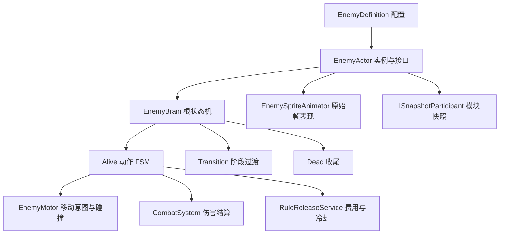

# 敌人系统接入

本模块按 `Doc/敌人逻辑` 的行为图和本次 `Doc/动画合集` 交付实现。当前范围是四个 Boss、积木分裂小怪和蝙蝠召唤物。旧策划案中的其它敌人不作为这版实现依据。

## 先运行白盒

在 Project 窗口打开 `Assets/_Project/Scenes/EnemyLabs` 中的场景，再进入 Play。每个场景有独立地形、可操作方块主角、一个敌人、规则系统和原有 Shift 轮盘。主角免疫伤害和击退，方便观察完整流程；免疫配置仅在白盒玩家 Prefab 中。

| 场景 | 主要观察内容 |
| --- | --- |
| `Test_Enemy_BrickBoss` | 距离选招，锤击、地面冲击波、投掷，三个分裂阈值，半血生气后分裂 |
| `Test_Enemy_BrickMinion` | 地面追击、接触攻击、受击与死亡 |
| `Test_Enemy_ClockBoss` | 三阶段指针激光，响铃后冲刺，三秒发条窗口，失败恢复 Boss 自身血量 |
| `Test_Enemy_RabbitBoss` | 出头/藏身二十秒轮换，半血翻转，规则施法后继续原动作；美术使用方块占位 |
| `Test_Enemy_BatBoss` | 三段劈砍、甩毛、飞行、阶段虚弱、召唤、指令、规则施法和三阶段冲刺 |
| `Test_Enemy_BatMinion` | 单独场景直接追击；Boss 召唤后先待命，收到前指命令再攻击 |

移动、跳跃、冲刺和攻击沿用 `Test_RuleSystem` 的 Input Actions 与主角控制参数。调试键：

| 按键 | 操作 |
| --- | --- |
| F1 | 将当前敌人生命调到下一阶段阈值；用于快速观察，不代表正式伤害结算 |
| F2 | 在发条暴露时击破发条 |
| F3 | 重开当前白盒，仅 Editor 可用 |
| F4 | 暂停/继续白盒 |
| Shift | 使用现有规则轮盘 |

发条成功路线：F1 进入二阶段，再按 F1 露出发条，三秒内 F2。失败路线：露出发条后等待，不按 F2。Rabbit 的第二次 F1 触发谢幕。积木第一次 F1 会分裂，之后等待过渡结束再按下一次。

这些场景没有加入 Build Settings。`EnemyLabControls` 只属于开发白盒，不挂到正式敌人 Prefab。

## 结构和职责

依赖 UnityHFSM 2.3.0（MIT，UPM 固定到 `v2.3.0`）。Boss 的动作是一层 FSM，外面是 Alive / Transition / Dead 的 HFSM。发条的三个指针使用独立计时，不阻塞身体动作。本版本不引入 Unity Behavior，避免给同一敌人配置两套决策和打断逻辑。

- `Gameplay/Enemy`：行为决策、阶段、移动、攻击、召唤、发条弱点和投射物。
- `Presentation/Enemy`：Sprite 帧播放、朝向与指针显示。动画不会反过来决定伤害和移动。
- `Data/Enemies`：定义与动画集合。配置是共享资产；生命、阶段、冷却、随机状态都保存在实例上。
- `Prefabs/Enemies`：六个敌人 Prefab 和独立 `EnemyLabPlayer`。
- `Editor/Enemy`：导入与白盒生成工具。

伤害继续经过团队的 `CombatSystem` / `DamageProcessor`，包括伤害反转、挂账和因果规则。敌人只在 `ApplyDamage` 中处理自身无敌帧、阶段锁血、受击与击退。单次攻击的目标集合用于防止一个判定窗重复打同一实体；蝙蝠三段斩各自开启新的命中集合。

规则施法使用 `RuleReleaseService`，来源为 `RuleSource.Enemy`。费用、冷却、时长、覆盖语义由共享系统决定，敌人不直接写全局时间或规则属性。`EnemyDefinition.RuleAttribute` / `RuleRelation` 可配置施放哪条规则；默认积木、兔子、蝙蝠使用重力弱化，发条使用时间弱化，均为白盒演示配置。

## 接入正式地图

1. 地图中先有团队的 `RuleSystemDriver` 与 `CombatSystem`，不要每个敌人再放一份启动器。
2. 拖入对应敌人 Prefab。为 `EnemyActor.Target` 指定正式玩家 Transform，为 `Combat` 指定地图里的战斗系统。
3. 将地形放入 Ground 层（当前 Layer 8），敌人放入 Enemy 层（Layer 9）。`EnemyMotor.SolidMask` 控制地形碰撞，`EnemyActor.PlayerMask` 控制攻击目标。默认白盒玩家在 Default 层；正式玩家使用其它层时必须改 PlayerMask。
4. 改 `EnemyActor.ArenaX` 为本次战斗区域的左右边界；发条折返与蝙蝠冲刺会使用它。正式地图需要更复杂的平台路线时扩展 Motor 的导航输入，目前只有地面追击、悬崖探测和直线飞行，不提供跨平台寻路。
5. 在 `EnemyDefinition` 调数值、攻击距离、冷却和动作时长。初始生命与能量由定义同步到 EntityStatus，改配置后重新运行即可。动画集合按动作名绑定，正式美术更换不会影响 Brain 和 Combat。
6. 地图流程监听 `EnemyActor.OnDefeated` 或团队的 `CombatSystem.OnEntityDied` 结束战斗、开门、掉落。敌人不会自行切地图、保存游戏或播放正式结算。

积木的 `MinionPrefab` 和蝙蝠的 `FlyingMinionPrefab` 已配置。召唤物自动继承 Target、Combat 和 Summoner；上限为八个活跃召唤物。Boss 死亡会结束自己的召唤物。项目中的正式玩家需要 `IFactionMember.Faction == Player` 才会被敌人攻击选中。

## 动画导入与交付缺口

本次导入 382 张 PNG，组成 35 个动作/指针序列；蝙蝠召唤物暂用 Boss 帧缩小显示。交付标注为每秒八帧，默认按原始节奏播放。移动使用 Rigidbody2D 插值，图像使用每个角色固定 PPU 和固定身体碰撞体，不通过逐帧改缩放补齐尺寸。

`Tools/EnemyAssets/import_resources.py` 从 Doc 复制 PNG，保留原图字节，记录来源、角色 PPU、尺寸与脚底锚点到 `EnemyArtManifest.json`。锚点取主要不透明区域，忽略远处的孤立导出标记。Editor 导入器使用 Sprite Editor Data Provider 设置 pivot 和导入参数。PSD、MP4、背景音乐、场景组件和序幕原稿留在 Doc，未批量导入运行时。

当前兔子文件夹为空，因此没有兔子动作帧；发条只有分针和时针，没有秒针，秒针暂用原时针图做细长版本。三根针以连接圆点为轴心，并跟随各帧表盘中心。兔子动画到位后，在 `RabbitBoss_Animations.asset` 配置 Pop、Throw、Hide、HideThrow、Flip、FlipThrow、Magic、Hurt、Dead 即可。动画资源缺失时使用 Idle 或现有白盒，行为仍可验证。

重新导入原始资源：先运行 Python 脚本，再在 Editor 调用 `EnemyArtImporter.Import()`。菜单 `RuleGame > Enemies > 重建全部敌人白盒（覆盖生成配置）` 会重新生成定义、动画集合、Prefab 和六个白盒。它会覆盖生成资产中的手工调参；正常调整不需要重建。

## 数值与文档冲突

积木 Boss 的生命 100、伤害 10，分裂小怪生命 11、伤害 5，使用动作需求表中已填写的数据。其它 Boss 的完整数值未交付：发条生命 150、蝙蝠生命 300、兔子生命 100、蝙蝠召唤物生命 25，均为可改的白盒默认值。部分行为距离、出手时点、激光预警和招式冷却也是演示配置，不代表最终平衡。

兔子普通投掷间隔存在冲突：Markdown 写 0.5 秒，行为 Drawio 写 2 秒，倒置投掷为 0.5 秒。本版普通/藏身投掷采用 Drawio 的 2 秒，可在 RabbitThrowInterval 修改。兔子半血翻转与低于 20 谢幕按交付的绝对生命阈值实现。

发条回溯失败只将 Boss 自身生命恢复到最大生命的 3/5，仍处于二阶段；不会触发玩家和世界回档。

## 世界快照接口

新增可选 `ISnapshotParticipant`：共享 SnapshotSystem 先恢复物理与 EntityStatus，再调用模块恢复。已有不实现该接口的实体保持原有行为。

敌人快照包含 HFSM 状态、阶段、动作进度、各攻击计时、移动速度/冲量、无敌帧、分裂标记、召唤关系和随机状态。投射物、激光和发条弱点各保存自己的模块状态。回到召唤/发射之前时，主动声明 `DiscardWhenMissing` 的临时对象会停用。死亡和过期对象停用而不立即 Destroy，仍存活的对象可被已有快照恢复。

这是现有内存快照的扩展，不是对话存档或持久化敌人存档。正式关卡在离开战斗区域时可以随场景统一清理对象；若要跨场景保存敌人状态，需要另行定义持久化数据。
