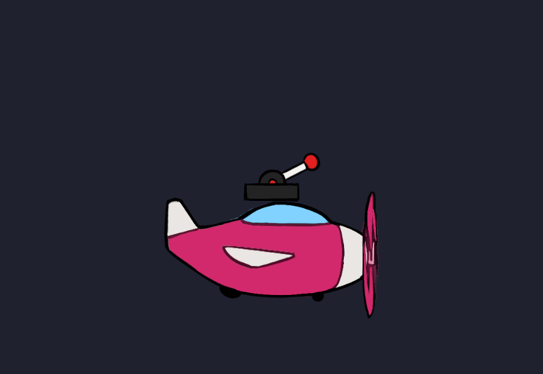

# 楼层电梯与多档拉杆

> 预制体：`Assets/_Project/Prefabs/BrickCity/CityFloorLift.prefab`（菜单 `Tools/规则游戏/积木城/⑮ 楼层电梯（拉杆随车走）` 重新生成）。
> **与旧的两站电梯完全分开**：`CityPathMotor` / `CityLift` / `CityLever` / `CitySwitch` 的玩法行为一行没改。

## 1. 它解决什么

- 电梯要停 **2 站或 3 站**（旧 `CityPathMotor` 只有一个 `TargetEnd` 布尔，只能两站）。
- 拉杆装在**车厢上**、跟着车一起走，玩家站在车上拨杆选楼层。
- 档位由「**从哪边打过来**」决定：站在左边砍 → 左档，中间 → 中档，右边 → 右档。

## 2. 层级（一个预制体，三个物体）

```
CityFloorLift   容器，无刚体、无碰撞体
├─ Car          [Ground 层 8]  Kinematic 刚体 + **1.3×0.5** 实心箱 + CityMultiStopLift + RuleAffectedBody
│               └─ Visual  飞机（SpriteFlipbook：CityLift_Plane_01/02，14fps 螺旋桨；等比缩到车宽）
└─ Lever        [Default 层 0] Kinematic 刚体 + **0.7×0.75** Trigger + CityFloorLever + RuleAffectedBody
                └─ Visual  摇杆（CityFloorLeverSpriteView：CityLever_01..05，22fps 按档换帧）
```



**尺寸**：关卡竖井统一 **3 格宽**（Grid 格 = 0.5 米 → **1.5 米**），所以车箱碰撞箱取 **1.3 × 0.5**，
每边留 0.1 米余量；飞机精灵按 `1.3 / 精灵宽` 等比缩放（约 0.433），机翼不再顶到槽边。
**不要再用缩放实例的办法** —— 缩放根物体同时会把 `_stops` 的位移一起缩放，站点距离会跟着变。

**美术来源**：`Art/Sprites/Components` 里的功能组件交付图（由 `CityArtSetup` 导入，飞机 PPU 146 / 摇杆 PPU 134，
精灵矩形已经按并集裁过透明画布），不另存副本。

- **飞机对齐「机舱顶」而不是包围盒顶**：机舱顶在精灵轴心上方 0.75，而尾翼顶到 0.894 —— 按包围盒对齐会让人悬空。
  生成器里的 `PlaneRoofLocalY = 0.75` 就是量出来的这个数；**换美术后要重新量**。
  车箱碰撞箱（1.3×0.5）的顶面 = 机舱顶，人站在机顶上，机身垂在平台下方。
- **摇杆按 5 帧换帧**（1 = 最右、3 = 竖直、5 = 最左），轴心在底边，正好落在机舱顶；不再走「旋转把手」那条路
  （`_handle` 留空，`_angles` 只在接旋转把手时用）。

⚠️ **拉杆是车的兄弟节点，不是子物体。** 每个 `CityMechanism` 都要自己的刚体，而 Kinematic 子刚体挂在父级
`MovePosition` 下面会**晚一个物理步**（2 m/s 一帧 4 cm，高速更明显）。随车由 `CityMultiStopLift._carriedBodies`
显式带：每步给随车刚体**同一个位移**。

## 3. 参数

### CityMultiStopLift（车厢）

| 字段 | 含义 |
| --- | --- |
| `_stops` | 站点 = **相对摆放位置的世界偏移**，从低到高。2 项 = 2 站，3 项 = 3 站，N 项都行 |
| `_speed` | 升降速度（米 / 秒），默认 2 |
| `_waitAtStop` | 到站停多久（秒），默认 0.4 |
| `_carryRiders` | 带走站在车上的人（默认开） |
| `_solidMask` | 什么层挡得住它（默认 Ground）。被挡住就停住，不硬挤 |
| `_carriedBodies` | 随车刚体（拉杆）。**不要把拉杆拖成子物体** |

### CityFloorLever（拉杆）

| 字段 | 含义 |
| --- | --- |
| `_angles` | 每档把手角度（绕 Z，度），默认 25 / −35 / −95；**长度应与站点数一致** |
| `_selectHalfWidth` | 选档半宽（米），默认 **0.45**（车箱收窄后的值）→ 3 档各 0.3 米；换宽车厢要同步放大 |
| `_reverse` | 档位左右对调（左段 = 最高站） |
| `_handle` / `_handleDegreesPerSecond` | 旋转把手用；**接交付美术时留空**（改由 `CityFloorLeverSpriteView` 换帧） |
| `_lift` | 拖车厢；留空会自动在父级 / 父级的子物体里找 |

表现层（`Presentation/Scene`）：

| 组件 | 挂在哪 | 作用 |
| --- | --- | --- |
| `SpriteFlipbook` | Car/Visual | 循环播飞机两帧（螺旋桨），暂停时冻结 |
| `CityFloorLeverSpriteView` | Lever/Visual | 读 `CityFloorLever.Position`，在 5 帧里前后播；档 0 = 最左 = 最后一帧 |

## 4. 档位怎么算

以拉杆为中心、± `_selectHalfWidth` 为范围，**平均切成 N 段**；打过来的点落在第几段就是第几档。

- 近战：传**玩家自己的位置**（不是攻击盒中心 —— 那个永远在身前 0.8 米，会整体偏一档）。
- 纸飞机：传**撞上去那一刻自己的位置**。
- E 键：同样按玩家位置算。
- 2 档时范围被切成左右两半，**正中算右半**（没有中间档）。

同一档重复打是安全的：电梯已经停在那儿，`SelectStop` 直接忽略。

## 5. 接线

1. 把 `CityFloorLift.prefab` 拖进关卡，摆在**最低站**的位置。
2. 按关卡高度改 `Car` 上 `CityMultiStopLift._stops`（相对偏移）与 `Lever` 上 `CityFloorLever._angles`（每站一个角度）。
3. 想让玩家能按 E 拨杆：确保主角身上有 `CityInteractor`（正式玩家预制体已挂）。
4. 攻击盒 / 纸飞机打中拉杆也会拨档（走 `IContactSwitch.ImpactByContact(sourcePoint)`）。

## 6. 注意

- **站点是相对偏移**：整台电梯搬家时站点跟着走；但**不要缩放**容器或 Car（子物体会继承缩放）。
- 车厢必须在 **Ground 层**（玩家的 Slide / 接地探测只认这一层）；拉杆放 Default 层，否则玩家会把拉杆当台阶站上去。
- 每个刚体只放一个 `CityMechanism` 派生组件（快照只采集第一个）。
- 拉杆与电梯的目标站互相同步：回溯或别的脚本改了 `TargetStop`，把手会跟过去。
- 电梯与拉杆都参与世界快照（`CityMechanism`），站点进度、目标站、档位都能被回溯还原。
