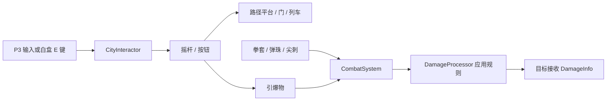

# 积木城地图组件

需求来源：策划《游戏组件需求大全(1).xlsx》的“地图功能组件类”与“地图瓦片类”。表内标为“全局”的组件作为积木城可用组件交付，不代表正式地图必须全部使用；魔王城专属溜溜球不在本批范围。

分支 `feat/brick-city-components` 从 `2343be2` 分出，包含当时已经合入的地图/主角以及 Boss 分支基础。后续提 PR 时需留意 Boss PR 的合并状态，只审本分支新增组件。

## 直接试用

- 打开 `Assets/_Project/Scenes/Test_BrickCityComponents.unity`，进入 Play。
- 场景使用现有 `LevelRuntime` 的主角与镜头，接入 `feat/rule-wheel-orb` 已提交的新版同心双层轮盘、朝向适配与托球柔光；选择期间为 0.001 倍速。移除旧 `P4Hud`，使用独立的中文演示提示。从左向右是八个试验区；`F1` / `F2` 切换下一个 / 上一个试验区，弹珠封闭试验房也通过该入口进出。
- `E`：操作附近机关。正式输入可直接调用主角上的 `CityInteractor.TryInteract()`，白盒按键只在 `BrickCityLabControls` 内。
- `F5`：整场恢复初始状态，并清空本轮演示奖励。
- `F6` / `F7`：标记 / 恢复世界快照，用于观察机关中途状态回溯。
- `F8`：回到最近一次手动激活的秋千检查点；未激活时无操作。
- `F9`：调试扣除 30 能量，便于测试石像回蓝。
- 地形复用 `Level_Start_01` 已有石头地板和平台纹理，按原图比例平铺；本地 `Level_01` 仍是早期白盒，因此本演示独立搭建同材质机关路线。两张原地图均不修改。机关形状与颜色用于辨认，不作为最终组件美术。角色继续使用项目当前版本。
- 状态与说明固定在屏幕边缘，字号为 24–40（1280×720 设计分辨率）；区域与交互说明全部为中文，并随所在区域切换，不再使用可能移出镜头的世界标牌。打开轮盘时收起机关说明与底部快捷键，避免遮住选项。旧 P3 调试面板只在本场景实例中禁用。

## 可拖用资产

全部位于 `Assets/_Project/Prefabs/BrickCity/`。

| Prefab | 用途 | 主要配置 |
|---|---|---|
| CityLift | 小飞机升降平台 | EndOffset、Speed、StationWait |
| CityGate | 升降门 | CityPathMotor；不承载角色，关闭时遇到角色停止 |
| CityLever | 摇杆 | FollowMotor 可直接拖入电梯/门，多处摇杆读取同一目标状态 |
| CityButton | 单次按钮 | OnChanged 连接门、拳套或炸弹的 SetOn(bool) |
| CityHammer | 弹簧拳套 | Stroke 可设上下/左右方向，等待、预警、出拳、停留、收回分别调节 |
| CityMarble | 受攻击可弹开的弹珠 | InitialVelocity、刚体质量/重力、CityDamageZone 伤害与间隔 |
| CityBubble | 起跳后破裂的平台 | RespawnSeconds 为 0 时只通过重置/回溯复原 |
| CityRefill | 回蓝石像 | Amount、Cooldown；能量已满不消耗冷却 |
| CityCheckpoint | 秋千检查点 | CheckpointId、SaveRequested；提供当前场景内存恢复 |
| CityChest | 宝箱 | SourceId、Kind、Amount、Receiver |
| CityReward | 三色龙珠 | 同宝箱；PickupVisual 在领取后隐藏 |
| CityTrain | 两站往返小火车 | 同路径平台；AutoReturn、StationWait；OnArrived 留给车站/场景流程 |
| CityBomb | 按钮引爆物 | Fuse、Radius、Damage、Knockback；圆形爆炸区域按实体去重 |
| CityThorns | 接触伤害占位块 | 独立形状危险区；正式瓦片尖刺仍复用 HazardField |

美术只需替换各 Prefab 的 `Visual` 子物体。根物体保存真实物理尺寸，避免用根缩放来适配图片。弹珠需要保持圆形碰撞体；平台、门、泡泡的碰撞尺寸应按正式图片再校准。

## 联动与伤害

`CityDamageZone` 使用显式重叠查询并按目标去重，不依赖主角是否收到触发回调。连续接触有逐目标冷却。拳套只有出拳与停留阶段伤人，黄色为预警、红色为有效伤害；停止运行会冻结当前阶段，继续运行从原阶段推进。

所有攻击仍由 `CombatSystem` 组装 `AttackInfo`，交 `DamageProcessor` 处理伤害与因果，再发送 `DamageInfo`。弹珠实现 `IDamageable`，不伪造生命条，读取处理后的击退并施加真实物理冲量；不是直接改主角血量。

## 平台与角色协作

平台在物理更新顺序 -40 提交承载位移，主角保留自己的移动速度，`MotionMover` 在唯一一次 Slide 中合并平台位移。下降时仅在这次 Slide 临时忽略支撑平台碰撞，其它墙、地面和天花板继续阻挡；起跳时不带走后续平台位移。

平台会预先检查自身与乘员的移动空间，受阻时停止推进路径进度。两端摇杆通过 FollowMotor 同步，不会因另一个摇杆操作过而需要多按一次。

## 规则与回溯

所有机关根物体通过 `RuleAffectedBody` 登记进世界注册表。每个根刚体只放一个 `CityMechanism` 或其派生组件，避免快照系统只采集到第一个模块。

- 动态弹珠：由刚体应用重力、质量、摩擦，受到时间规则和物理碰撞影响。
- 电梯、门、列车和拳套是有动力/导轨的机关：按路径推进，时间倍率影响推进速度；不会因为重力反转擅自脱轨。是否需要某个特殊规则改变机关方向，由关卡配置另行扩展。
- 路径进度、目标站、停站余时、拳套阶段/计时、开关状态、泡泡破裂/重生余时、回蓝冷却、炸弹引信、接触伤害冷却均随快照恢复。
- 破裂或消耗时保留 GameObject，关闭碰撞/显示，不 Destroy，回溯才能恢复。

## 需要主程接入的正式接口

### 存档

`CityCheckpoint.SaveRequested(string checkpointId)` 为正式保存入口。组件自身的 TryRespawn 只恢复当前游玩的内存世界快照，不写磁盘，也不保证重开游戏后有效。主程可监听事件保存自己的进度/关卡数据。

### 奖励与升级

`ICityRewardReceiver` 定义 IsClaimed(sourceId) 和 TryGrant(sourceId, kind, amount)。每个宝箱/龙珠场景实例必须配置唯一 SourceId，并把实现该接口的组件拖入 Receiver。

没有适配器、ID 为空或适配器拒绝发奖时，机关不消耗。适配器必须原子完成奖励与已领取登记；时间回溯后结合永久领取记录恢复显示，不会通过反复开箱刷奖励。具体奖励是否为永久进度需主程与策划确认；当前适配接口按永久领取设计。

组件需求表“地图功能组件类”第 13 行将龙珠定义为全局宝箱奖励，三色对应战斗力、血量和蓝条升级；没有规定积木城必须摆放三颗。演示场景单独摆放三色拾取物用于检查奖励接口，正式关卡按策划布置。

白盒的 BrickCityLabControls 只维护三个演示计数，不修改主角攻击力/最大生命/最大能量，也不是正式经济或升级系统。正式接入后移除此演示适配器与调试按键。

### 跨地图列车

CityTrain 已提供两站运动与承载。OnArrived(bool atEnd) 可接进出站表现和关卡流程。正式目的地图、转场、加载与存档由场景系统处理，本批不在组件内硬编码地图名字。

## 重新生成

菜单 `Tools/规则游戏/积木城/生成组件与白盒` 会覆盖本批 14 个 Prefab 和独立测试场景。正式关卡应使用场景实例覆盖或自己的 Prefab Variant，不要把正式关卡编辑写进该白盒后再重建。

本工具不会更改 LevelRuntime、P4Hud、正式地图或 Build Settings。新版轮盘仅按文件引入其已提交的运行时代码、布局、光球数据和材质，不覆盖轮盘分支上的主角参数或测试场景。正式机关美术、动画、音效和图文说明交付后，再替换 Visual 与事件表现。

本轮用 Unity 6000.6.4f1 生成实际资产，并在新白盒中完成 8 项定向 Play 检查：双端摇杆、电梯升降承载、关门受阻、泡泡起跳与回溯、弹珠击退、接触伤害与回蓝冷却、拳套/引信回溯、检查点与奖励防重复。首轮 7 项通过；拳套用例原先依赖固定步数，改为等待实际攻击窗口后只补跑该项并通过。记录保存在本地 Library/BossFixReview/CityChecks.txt 与 CityChecks-retry.txt。

未重跑整套敌人/主角检查，也未构建 Player。字体图集原有本地改动已原样保留。最终美术、按键手感、正式关卡组合和存档后端需要后续手动/联调验收。

本次演示表现更新已在编辑器实际导入、重建场景并进入 Play：确认新版轮盘开关、托球柔光和大字中文提示正常；常态与轮盘两张画面均已查看，未见文字裁切。石头图按原素材左上角锚点与碰撞体对齐。仅因首次画面暴露旧调试浮层与地形锚点问题、后续用户要求放大字体而定向复查，未重跑机关行为套件。一次性编辑器任务已移除。
