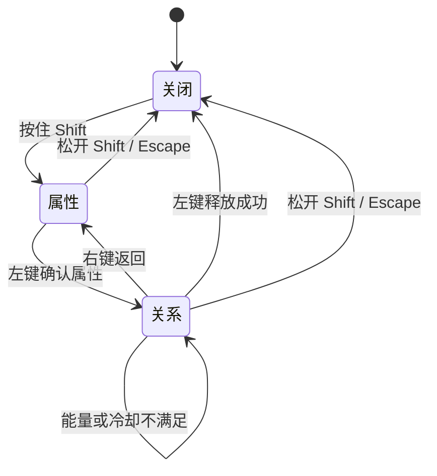

# 规则轮盘接入

基于已合入 `main` 的 P2/P3 正式玩家、规则目录与释放服务实现。按新策划案批注采用慢时间选择：世界继续运行，玩家输入临时交给轮盘；不用旧白盒的暂停与预览扣费控制器。

## 试播

执行 **RuleGame → Rule Wheel → Open Test Scene**，或打开 `Assets/_Project/Scenes/Test_RuleWheel.unity`，进入 Play Mode。

场景直接复制队友的 `Test_RuleSystem.unity`：保留地形、冰面、箱子、木桩、P3 玩家输入、碰撞层和手感配置；玩家只替换成黑色方块与白眼。原场景不改。副本关闭 P2/P3 的旧调试面板，由新 UI 提供状态和规则入口；不会修改 Build Settings。创建菜单只生成缺失副本，已有副本的手动改动会保留。

- A/D 移动，Space 跳跃，鼠标左键近战。
- 按住 Shift 进入约 0.1 倍慢时间，镜头推近玩家。鼠标移到右侧扇区，左键确认属性，再选择关系并左键释放。
- 松开 Shift 或按 Escape 取消；关系阶段右键返回属性阶段。成功释放后必须先松开 Shift，才能再次打开。
- 手柄用右扳机进入、右摇杆选择、X 确认、B 返回。
- R 清除规则并恢复试播能量。该键只属于试播工具，不作为正式重开关卡服务。

这里把「按 Shift 时」具体落实为长按模式，松开取消。它是可体验的交互约定，若团队决定改成开关式，改输入适配即可，选择状态机和释放服务无需重写。

6 属性仍全部可见，时间和因果尚未实现，显示为不可用；当前目录的重力、摩擦、质量、伤害规则直接走 P2/P3。显示器不生成假效果、不自行扣能量。能量不足或冷却中，失败后保留当前世界规则和选择阶段。

## 正式接入

创建 UIDocument，指定 `RuleWheel.uxml` 和 PanelSettings，添加 `RuleWheelPresenter`，绑定 P3 PlayerController、正式 RuleCatalog、已解锁查询组件、时间来源、镜头来源和世界 Camera。

### Inspector 接线

UIDocument 使用 `Assets/_Project/UI/RuleWheel/RuleWheel.uxml`，PanelSettings 可复用同目录的 `RuleWheelPanelSettings.asset`。布局和字体、字块配色在 UXML/USS 中维护，不需要修改释放服务。

`RuleWheelPresenter` 的引用与参数：

- `_player`：正式玩家物体上的 `PlayerController`。其同物体须有 `EntityStatus`，UI 会检查玩家是否启用及是否完全暂停。
- `_catalog`：当前规则系统使用的 `RuleCatalog`。不要另建一份只供 UI 扣费或计时的目录。
- `_unlocks`：实现 `Gameplay.Player.IRuleUnlocks` 的 MonoBehaviour；只查询属性/关系是否已经解锁。试播使用 `RuleWheelLabUnlocks`，正式场景接库存查询组件。
- `_timeSource`：实现 `IRuleSelectionTimeSource` 的 MonoBehaviour。正式场景接 P1 时间管理组件，试播才接 `RuleWheelLabTimeSource`。
- `_cameraFocus`：实现 `IRuleSelectionFocus` 的 MonoBehaviour；示例使用 `RuleSelectionCamera`。
- `_worldCamera`：实际绘制玩家的 Camera，用来把玩家的世界位置换算成轮盘屏幕位置。
- `_selectionScale`：默认 `0.1`。它是选择模式倍率；试播会乘以进入前的时间倍率，不强行覆盖成固定的全局值。
- `_playerOffset`：默认 `(70, 0)`，以 Panel 坐标控制轮盘在玩家右侧的偏移，并限制轮盘不越出屏幕边缘。

`RuleSelectionCamera` 的引用与参数：

- `_target` 指向玩家 Transform。
- 场景已有 `P3FollowCamera` 等跟随组件时，把它拖入 `_normalFollow`。选择时暂时禁用原跟随，取消或成功释放后平滑回拉，再恢复其进入前的启用状态。
- `_selectionOffset` 默认 `(1.3, 0.35)`，给右侧轮盘留空间；`_selectionSize` 默认 `2.8`，是特写时的正交尺寸；`_transitionTime` 默认 `0.18` 秒。
- 特写与回拉按非缩放时间推进。回拉完成以缩放恢复为依据；玩家边走边取消时，不会因一直追赶移动目标而永久占用镜头。
- 绑定了 `_normalFollow` 时，平时的位置由原跟随组件维护；不要再添加另一个持续写同一 Camera Transform 的跟随脚本。

### 运行链路与失败处理

1. 玩家按住 Shift，Presenter 依次申请时间、输入和镜头令牌；必需引用缺失时会输出配置错误并禁用组件。
2. 属性阶段只进入下一层，不执行规则、不扣能量。只有目录中存在且已经解锁的属性可以进入关系阶段。
3. 关系阶段读取正式目录、解锁状态、冷却和能量，显示当前可用性。时间和因果保留入口，但当前目录未实现时不可释放。
4. 攻击键确认后调用既有 `RuleReleaseService.TryRelease`，由 P3 请求 P2 执行规则。能量、冷却以及生效中的规则与剩余时长仍由原系统维护。
5. 成功后关闭 UI 并释放令牌；能量不足、冷却中或尚不可用时留在关系阶段并显示提示，不先扣费，也不删除已有规则。
6. 松开 Shift、Escape、失焦或禁用组件都走同一关闭路径。取消不产生规则、不扣费，关闭当帧的确认键不会再传给近战。

移动输入被临时接管时，玩家原来的 FixedUpdate 仍然执行：重力、碰撞与外部冲量继续按慢时间推进。轮盘不会调用 `EntityStatus.SetPaused`，也不接管 `Physics2D.Simulate`。

### 文件职责

运行期职责：

- `Gameplay/Scene/Rules/RuleSelectionSession` 管两级选择和可用性，使用现有 `RuleReleaseService.TryRelease`，请求成功后由 P3 结算。
- `UI/RuleWheel/RuleWheelPresenter` 读轮盘输入、显示内容、申请与释放接管令牌；静态布局在 UXML/USS。
- `UI/RuleWheel/RuleFan` 用 Painter2D 绘制纸扇，扇区命中与标签位置共用半径、角度参数。参数可在 UI Builder 的自定义元素上调整。
- `Presentation/RuleWheel/RuleSelectionCamera` 提供临时特写和回拉。副本的 `_normalFollow` 绑定队友的 `P3FollowCamera`：只在选择与回拉期间禁用它，回拉结束后归还；平时继续使用队友原来的跟随。没有既有跟随组件时，才使用此组件内置的正常跟随。

P3 PlayerController 新增 `BlockGameplayInput()`，返回可释放令牌，只阻止输入，不阻止 FixedUpdate。最后一个令牌释放当帧仍吞掉确认输入，避免规则释放和近战同时触发。原来的 `EntityStatus.SetPaused` 仍按 P3 的完全暂停语义工作，轮盘不调用它。

## P1 与 P3 接管点

三个令牌接口放在 `Infrastructure/Shared/Interaction/`，无上层程序集依赖：

- `IRuleSelectionInputGate`：接管玩家输入，释放当帧不把确认键漏回战斗。
- `IRuleSelectionTimeSource`：P1 为选择模式申请独立时间来源，合成现有时间规则，释放后恢复其它来源的结果。无法进入选择时返回 null。
- `IRuleSelectionFocus`：镜头组件提供临时特写令牌；UI 不引用具体镜头类。

时间来源和镜头来源通过 MonoBehaviour 引用并检查接口。正式组件可以替换而不用改轮盘状态机。失焦、禁用、取消和成功释放都统一关闭并释放令牌。

`Development/RuleWheel/RuleWheelLabTimeSource` 仅是试播适配器：保存进入前的 timeScale / fixedDeltaTime，按选择倍率调整，并只恢复自己仍持有的值。Unity 写入步长后会量化，所有权判断使用实际读回值，避免松开 Shift 时漏掉步长恢复，反复取消导致物理计算次数暴增。它不能代替 P1 的多来源时间管理器，不能作为正式存档、暂停或时间规则实现。`RuleWheelLabUnlocks` 仅供试播开放词条，正式场景替换成实现 P3 既有 `IRuleUnlocks` 的库存查询。

P1 接入时，实现共享接口并替换 `_timeSource` 引用即可：申请一个名为选择模式的临时时间来源，与其它来源合成，令牌的 `Dispose()` 移除该来源。被完全暂停、切换关卡等状态禁止进入选择时，申请方法返回 null；不要把试播适配器的单一全局值保存/恢复逻辑直接当成多来源管理。

P3 接入时，保留 `BlockGameplayInput()` 的令牌语义。多个输入持有者并存时，只释放自己持有的阻塞；最后一个令牌释放后才恢复玩家输入。解锁查询通过已有 `IRuleUnlocks` 接口接入，不需要让 UI 依赖库存内部实现。

正式关卡接入不需要 `Development/RuleWheel`：生命/能量显示可接现有 HUD，规则选择使用 Presenter、状态机与共享接口即可。`RuleWheelLabHUD` 的 R 键仅清空规则、恢复能量，不重置角色位置或存档；销毁试播场景时会清理规则并恢复进入前的重力。

没有新增程序集；功能分别放入已有 Gameplay、UI、Presentation、Development 和 Editor。UI / Editor 增加 Input System 引用以处理输入和场景接线。
