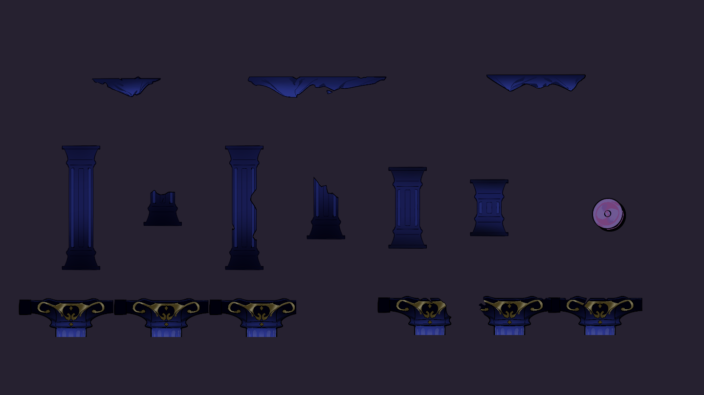
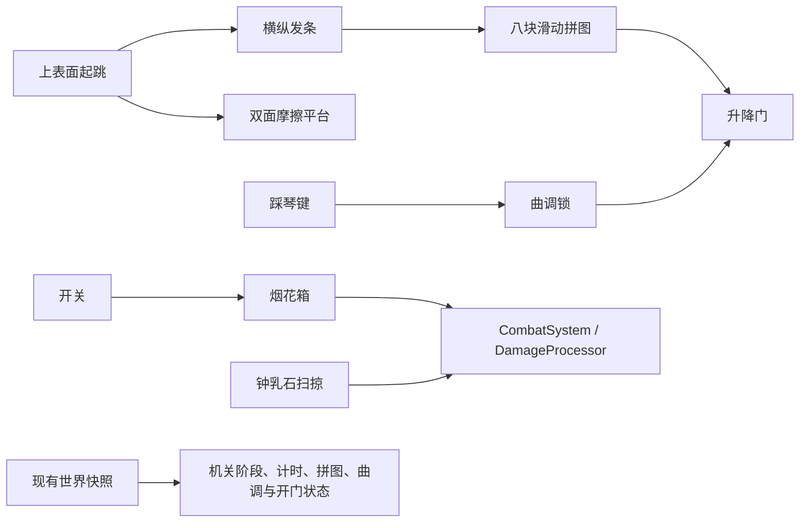

# 魔王城地图组件

依据本次提供的《游戏组件需求大全.xlsx》：“魔王城组件”第 2—10 行、“地图瓦片类”第 6 / 12 行，以及“发条王国组件”第 5 行的共用滑板车。需求摘录与来源校验值保存在 `Doc/References/DemonCastle/DemonCastleRequirements.json`。表格作为设计数据使用。

本批交付可运行的地图机关、32 个可拖放预制体、Tools 平铺放置菜单和独立演示场景。已从补充的素材目录接入 13 张魔王城地形、按钮两种状态和溜溜球两帧，共 17 张原始 PNG；源图逐字节保留，只通过 Unity SpriteRect 去除透明画布。来源和校验值见 `Doc/References/DemonCastle/DemonCastleArtSources.json`。

烟花箱、弹簧、铁块、钟乳石、翻转平台、发条、拼图、木马、琴键、滑板车和机关门的正式美术未在所给目录找到，用户确认没有其它位置，继续保留功能及占位外观；琴音仍为合成提示音。溜溜球没有对应行为定义，本批只提供双帧循环的美术预制体，没有增加伤害或运动机关。

## 在 Editor 中放置

打开 **Tools → 规则游戏 → 地图组件 → 魔王城**，17 个机关单体及组合件直接平铺列出，点击名称即放在 Scene 视图中心，并选中新实例。可继续在 Scene 中移动和调参；Ctrl/Cmd+Z 撤销，重做仍保留预制体连接。

所有资产位于 `Assets/_Project/Prefabs/DemonCastle/`，也支持从 Project 面板直接拖入场景。根物体保持单位缩放，调整物理尺寸用 Collider2D，调整美术用子物体。Prefab 编辑模式中默认放到当前 Prefab 根下。

“补齐组件预制体”只创建缺失资源，并在首次接入交付美术时更新本批地面、短/长平台与烟花组合内的按钮；使用导入版本标记避免反复改写。已接入后的碰撞、外观调参和机关引用保留。需要从默认值重建某个资产时，先备份自己的改动，再删除对应资产并补齐。正式关卡推荐使用实例覆盖或 Prefab Variant。

## 组件与接线

| 预制体 | 行为及主要参数 |
|---|---|
| DemonGround | 已接入魔王城地块 1，按原比例平铺，Ground 层，默认碰撞 8×1。 |
| DemonPlatformSmall / Long / Square | 短/长平台已接岩石平台 1/2，外观等比缩放并对齐碰撞顶面；碰撞仍为 2×0.4、4×0.4。Square 保留 2×2 占位外观。 |
| DemonFirework | 开关点火，默认引信 1.2 秒、半径 3、基础伤害 30；重复点火无效。可从 CitySwitch 的 FollowMotor 指定，或用事件调用 SetOn(bool)。 |
| DemonFireworkSwitch | 已连接的烟花箱＋踩踏按钮。按钮已接两帧美术，随状态和快照恢复切换；触发框匹配按钮外形。踩按钮点火，也可通过 CityInteractor 交互。 |
| DemonSpring | 圆盘跳跃弹簧，压缩、短暂停留、回弹。默认弹射速度 18，锚点以放置位置为准。 |
| DemonRustBlock | 16 kg 动态铁块，默认摩擦 0.7；推力、质量、摩擦、重力走项目现有系统。正常较难推动，质量或摩擦削弱后更容易推走。 |
| DemonStalactiteShort / Medium / Long | 三种长度。检测玩家在下方后预警 0.55 秒、向下落，扫掠地面与受击箱；落地后隐藏并关闭碰撞，保留回溯对象。探测深度、宽度、伤害与加速度可调。 |
| DemonFlipPlatform | 从平台上表面起跳翻转 180°，旁边跳跃不触发。红面摩擦 1.6，蓝面摩擦 0.02；只旋转 Face 外观，支撑碰撞体稳定。 |
| DemonWindingHorizontal / Vertical | 在发条上起跳，空格横／纵移动一格，到边界自动反向。单独放置时需指定 Puzzle。 |
| DemonSlidingPuzzle | 3×3 八块滑动拼图，按合法移动打乱，保证可解。可设种子、打乱步数、格距及八块美术引用。按 1—8 行优先排列、右下为空时触发 OnSolved(true)。 |
| DemonPuzzleRoom | 已连接的拼图＋横发条＋纵发条＋门，可直接放入关卡。 |
| DemonCarousel | 木马升降平台，默认向上移动 3 单位、速度 1.5、两端停 0.5 秒。复用 CityPathMotor 的往返、阻挡和乘员承载。 |
| DemonPianoWhite / Black | 踩上琴键发一次音，持续站立不连发，离开后可再次触发。默认白键编号 0、黑键编号 1。单独放置时需指定 Melody；支持替换 Clip。 |
| DemonPianoRoom | 两个琴键＋曲调锁＋门；默认曲调白、黑、白、白、黑，即 `[0,1,0,0,1]`。5 秒未输入清空进度；错音保留仍可成为正确前缀的尾音。 |
| DemonSkateboard | 魔王城共用滑板车，默认水平往返 5 单位，站上随行、起跳离开。 |
| DemonGround02 / 03 / 04 | 已交付地块的残缺变体，保持图片比例。 |
| DemonPlatformMedium | 已交付岩石平台 3，按原图比例和尺寸提供独立平台。 |
| DemonPillar01—06 | 完整柱、底座、破损柱与各段立柱；Ground 层，碰撞尺寸对应裁切后的外形包围盒。 |
| DemonYoyoVisual | 已交付溜溜球双帧循环，暂停冻结。仅美术预览，无伤害与碰撞。 |

交付地形按 128 PPU 导入，Bilinear 过滤、关闭 Mipmap；短/长功能平台在其子物体中等比缩放，保持原碰撞顶面与角色落脚高度。按钮、溜溜球分别共用序列并集裁切框和中心轴心，避免切帧跳动。生成代码使用 Sprite Data Provider 编辑裁切数据并检查编辑能力，没有手写纹理 `.meta`。

单独的拼图、琴键、发条用于自由组合；组合房间中的引用和开门事件已接好。自建门可复用 `CityPathMotor.SetOn(bool)`，或给 OnSolved / OnUnlocked 配置其它流程。

## 规则、暂停和回溯

- 新机关复用 `CityMechanism`、`RuleAffectedBody`、`ISnapshotParticipant`，不创建额外规则、时间或快照单例。每个根刚体仅一个快照模块。
- 暂停读取 `TimeManager`；物理状态在 FixedUpdate 推进。引信、落石、弹簧、翻转、发条冷却和曲调计时均冻结。
- 伤害查询只认 `Hurtbox.Mask` 的 Trigger，并通过 `CombatSystem` 的准入和 `DamageProcessor` 处理基础伤害；同一承受方多个受击箱不重复扣血。
- 烟花与落石消耗时保留对象，回溯恢复显示、碰撞、阶段和计时。快照恢复不重发开门／爆炸事件；门恢复自己的快照。
- 动态铁块直接响应质量、摩擦和重力规则。双面平台按当前面提供基准摩擦，玩家侧继续应用世界摩擦规则；其 RuleAffectedBody 不再重复覆盖两面材质。
- 有轨载具按配置路径运动，钟乳石按机关定义向下落；没有把这些有约束的机关改成自由落体实体。
- 需要正式场景已正常初始化现有 LevelRuntime / RuleSystemDriver、世界登记、CombatSystem 和世界快照。单独把危险机关放进一个空场景，不会创建主角或启动整个游戏。

## 组件测试场景

**Tools → 规则游戏 → 地图组件 → 魔王城 → 打开测试场景**，或直接打开：

`Assets/_Project/Scenes/Test_DemonCastleComponents.unity`

测试场分 12 区：烟花与按钮、弹簧、规则铁块、落石、翻转平台、发条拼图、升降木马、钢琴门锁、滑板、地形试跳、六种立柱、溜溜球展示。层级按 Zone_01—12 分组，地面统一放在 00_Ground 下。

进入 Play 即可测试，生命与能量显示在右上角；说明按玩家位置切换，打开规则轮盘时收起说明。

- 下拉框 / F1 / F2：跳转试验区；跳转位置同时作为本场测试复活点。
- F5：恢复初始机关状态、回到第一试验区、恢复生命与能量。
- F6 / F7：标记 / 恢复世界快照，用于引信、落石、翻面或运动中途的回溯测试。
- F9：补满能量，便于重复试用规则。
- E：沿用机关交互；常规移动、跳跃和规则轮盘沿用现有主角操作。

该场景没有加入 Build Settings，也没有改写现有 Boss 或正式地图。

“生成测试场景”在交互式 Editor 中保留已有场景，仅在缺失时新建；“重建测试场景（重置布局）”用于主动重置本测试场的布局。

默认拼图种子 17 的可用测试按键顺序（H / V 表示分别从对应发条上起跳）：`HVHVHHHVVHVVHHHVHV`。这是初始局面的调试辅助，已经操作过后可用先前快照恢复再验证。

## 功能核对与使用条件

不能把“32 个预制体”理解成“32 个独立机关”。其中 14 个是带碰撞的静态地形，17 个是机关单体或组合件，1 个溜溜球是纯美术件。

| 类别 | 已实现并验证的行为 | 放置后的接线要求 |
|---|---|---|
| 地面、平台、立柱、残缺地块 | 静态支撑和阻挡，Ground 层；已交付素材保持比例 | 场景已有正常配置的主角碰撞层 |
| 烟花箱 | 点火、引信、爆炸伤害、受击箱去重、暂停与回溯 | 单体需接开关；烟花＋按钮组合已接线，真实玩家接触可触发 |
| 跳跃弹簧 | 压缩、停留、回弹，实际主角被弹起 | 直接放置在可到达的地形处 |
| 生锈铁块 | 玩家推力探测、动态刚体、质量和摩擦规则；质量削弱后实际更易推动 | 共享规则系统正常启动 |
| 钟乳石 | 玩家位于下方时预警、下落、真实受击伤害、落地消耗、回溯 | 共享战斗系统正常启动 |
| 翻转平台 | 从上表面起跳翻面，切换粗糙/冰面材质，快照恢复面向 | 直接放置 |
| 发条与八块拼图 | 横/纵移动一格、边界反向、可解打乱、还原判定与开门 | 单发条需指定 Puzzle；拼图本体需配发条；拼图房组合已接线 |
| 升降木马 | 上下往返、实际承载主角、返回时继续承载、暂停与回溯 | 直接放置，可调终点偏移 |
| 琴键与曲调锁 | 实际踩键发音、正确序列开门、错音处理、超时和快照 | 单键需指定 Melody；钢琴房组合已接线 |
| 滑板车 | 水平往返，实际承载主角及回程承载 | 直接放置，可调路径 |
| 溜溜球 | 双帧循环和暂停 | **仅动画，没有伤害、碰撞或额外机关行为** |

工具位于 **Tools → 规则游戏 → 地图组件 → 魔王城**，仅列出 17 个机关单体及组合件，直接平铺；需接线的单体在菜单名称中注明。地形、立柱和溜溜球不在 Tools 菜单中，资源仍可从 Project 面板拖入。测试场景与补齐资源命令也在同一级。地图组件下其它既有条目保持原位置。

## 验证记录

2026-10-18，Unity 6000.6.4f1，完整隔离工程 `/tmp/rule-demon-castle-20261018`：`DemonCastleValidation.RunBatch` 共 **87 项通过、0 失败**。包括 21 个实际 Prefab 的脚本引用、重复补齐保留参数、放置/撤销/重做、圆形爆炸与多受击箱去重、引信暂停及回溯、实际起跳翻面与摩擦切换、通过双发条完成打乱拼图并开门、曲调错音/超时/实际踩键/开门、落石下落与回溯、真实主角弹簧弹射、铁块质量规则、木马运动/暂停，以及三幅实际 URP 渲染检查。

日志：`/tmp/rule-demon-final-validation.log`；结果：隔离工程 `Logs/DemonCastleValidation.txt`；渲染截图：`Logs/DemonCastlePreview/`。运行中仍可见项目已有的 Unity Search 索引异常，不属于新增机关调用。没有执行正式关卡完整流程、目标平台构建或最终美术验收。

2026-10-18 美术接入补充验证：同一 Unity 6000.6.4f1 完整隔离工程中，**124 项通过、0 失败**，包括 32 个实际 Prefab、17 张精灵裁切和导入参数、两组序列的共同轴心、平台比例及碰撞顶面对齐、按钮状态/快照切帧、原有机关回归以及实际美术的 URP 渲染。日志 `/tmp/rule-demon-art-validation.log`；预览保存于 `Doc/Preview/DemonCastle/DeliveredArt.png`。17 张源图的 SHA-256 与交付目录一致。正式关卡流程、最终美术完整性和目标平台构建仍未验收。

平铺地面放置范围另经 Editor 检查覆盖完整 8 单位宽度，日志 `/tmp/rule-demon-art-preview-bounds.log`；当前工程中的实际面板已核对预览与美术状态显示。

2026-10-18 功能补查与菜单整理：`DemonCastleValidation.RunBatch` 在既有隔离基线上共 **135 项通过、0 失败**，新增真实按钮接触点火、落石受击去重、木马/滑板车往返承载、玩家推力探测与质量削弱后实际位移的检查。菜单反射检查确认魔王城入口统一位于 `Tools/规则游戏/地图组件/魔王城`，且无重复路径。日志 `/tmp/rule-demon-function-audit.log`。本轮没有修改机关运行代码、正式场景或其它地图组件菜单，也没有执行整关/目标平台构建。

2026-10-18 测试场完善：沿用 Test_DemonCastleComponents，增加 12 区层级、全部静态地形变体/立柱/溜溜球、试验区下拉导航、随位置切换说明、生命/能量、F5 初始重置、F6/F7 世界快照、F9 补能和每区复活点。以本轮开始时当前完整工程复制到 `/tmp/rule-demon-scene-20261018`，运行 `DemonCastleValidation.RunBatch`，**150 项通过、0 失败**，包含新增区域实例、导航、HUD、快照和重置检查。日志 `/tmp/rule-demon-scene-validation.log`。当前 Editor 已实际打开本场景进入 Play，确认主角、中文 HUD、F1 跳转；测试后退出 Play，停在该场景。下拉框文字对比度单独调整并编译核对，日志 `/tmp/rule-demon-scene-ui-compile.log`。未执行 Player 构建。
